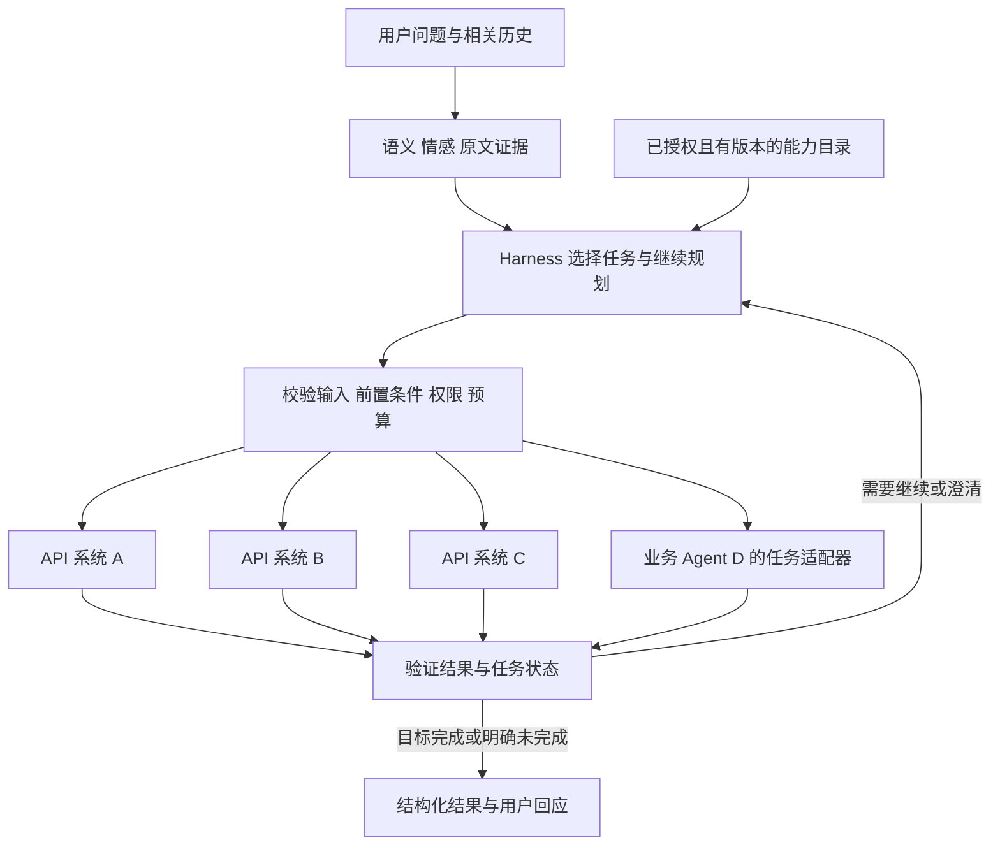

# 政府业务总入口 Agent POC 评估与方案 DRAFT v0.3

日期：2026-10-09。状态：架构与源码评估后的实施提案。

业务模拟与具体实施以 [v0.4](government-entry-agent-poc-v0.4.md) 为准：BALADY、SAKANI、940、FURAS 已替换本文的通用 A/B/C/D 示例，并提供可运行的模拟底座。本文件保留开源选型与架构评估依据。

让数字人作为统一入口，根据用户问题选择 API 或专业 Agent、组合任务并按执行结果调整计划，是合理且已有公开实现的方向。建议复用现成 harness 的模型接口、工具循环、会话和扩展机制，通过业务插件补充语义情感分析、能力目录、执行约束与评测。首轮优先验证 Pi SDK + DeepSeek，以三个 API 模拟系统和一个远端 Agent 模拟系统检验动态规划。

本方案扩展 [Semantic Analysis POC v0.2](semantic-analysis-poc-v0.2.md) 的入口与编排范围。原有测试数据生成、语义情感指标和自动回归设计继续使用；新增任务选择、规划及执行轨迹评测。本轮没有安装、运行开源项目或测得模型效果。

## 对思路的评估

| 想法 | 判断 | 实施条件 |
| --- | --- | --- |
| 系统数量不固定，入口动态选择业务能力 | 合理 | 每个已接入系统提供可信能力描述、契约、权限与前置条件。模型不能使用没有登记或无法理解接口的系统 |
| 三个 API 系统和一个 Agent 混合接入 | 可行 | API 封装成 typed tools；已有 Agent 通过任务适配器归一化状态、证据、追问和失败 |
| 复用 Pi 或 DeepSeek Harness，避免从零开发 | 推荐 | 使用 SDK 或经过裁剪的运行配置；复用循环与资源管理，业务合同和评分器由本项目实现 |
| 插件注入意图与情感识别 | 可行 | 作为入口保证执行的结构化分析能力，绑定原文证据并保持标签版本；不能只放一段可被模型跳过的 Skill |
| Harness 已具备可靠动态规划 | 需要修正 | 它提供模型决策和工具调用机制，不保证业务任务完整、关联正确或完成。必须以业务状态和执行轨迹验证 |

固定外层阶段可以包含理解、发现、规划、校验、执行与验证；具体业务系统、任务内容、调用顺序和是否需追问由当前问题及目录决定。这样保留可测试的运行约束，同时支持业务能力扩展。

## 已有公开实现

Microsoft Copilot Studio 的 generative orchestration 使用意图、工具和 Agent 的描述及输入输出形成多步计划，执行并对缺失信息追问；其官方文档也说明关键动作应由确定性规则或拦截层约束。这是与本方案接近的商业业务入口机制。[架构说明](https://learn.microsoft.com/en-us/microsoft-copilot-studio/guidance/generative-orchestration)

其 FAQ 在本次读取时仍写明 generative orchestration 仅支持英语，因此这里用于架构参照，不能作为沙特阿语能力的证明。[FAQ](https://learn.microsoft.com/en-us/microsoft-copilot-studio/faqs-generative-orchestration)

Amazon Bedrock Agents 的 supervisor/collaborator 模式提供总入口统一规划与调用专业 Agent 的实现。当前官方说明该服务已为 Agents Classic，不再接受新客户，既有客户可继续使用；可借鉴其分工，不能据此建议新项目直接采用 Classic。[多 Agent 协作](https://docs.aws.amazon.com/bedrock/latest/userguide/agents-multi-agent-collaboration.html)

开源侧已核验 Pi、DeepSeek Harness、Deep Agents 和 OpenCode。它们提供实际的工具循环、插件或工具扩展及模型配置接口。公开可用的机制证明本方向可实施；本次没有核实与 MOMAH 相同的沙特政府总入口生产部署案例。

## 开源底座比较与建议

| 底座 | 可复用部分 | 主要改造与风险 | 本 POC 判断 |
| --- | --- | --- | --- |
| Pi SDK | 多模型接口、会话、tool loop、extensions、skills、事件、脚本测试模型 | 不内置完整系统权限；默认编码工具及自动资源加载需替换；政府任务与结构化最终结果需实现 | 首选轻量插件 POC，使用受控 SDK |
| DeepSeek Harness | 插件化模型、工具、循环、Skill、MCP、政策 hook、会话日志、TS/Python SDK | 官方 developer preview；接口可能不兼容升级；Cordis 组合和子进程管理有学习成本；默认编码能力需裁剪 | 与插件思路高度接近，作为备选与适配对照 |
| Deep Agents SDK | 基于 LangGraph 的现成循环、模型、tools、skills、子 Agent、checkpoint、结构化输出 | 默认工具为叠加方式，需要显式裁剪；运行与委派预算必须限制；当前读取包标为 Beta | 若采用 Python/LangGraph，可直接作为主底座 |
| OpenCode | coding agent 服务、SDK、plugins、tools、模型与结构化输出 | 额外 server 和工作目录语义；政府入口要清理编码默认行为 | 次选，本阶段收益较少 |

四个项目读取的 LICENSE 均为 MIT；依赖许可与实际部署条件仍需在实施时核对。工作量判断来自公开接口和源码范围，尚未测量相同插件在各底座上的开发耗时。

建议先选一个底座做完整 POC，保持一个内部 `EntryAgent.run(request, capability_snapshot, model_config)` 接口，方便后续替换。优先不 fork 上游核心，通过公开 SDK、extensions、tools 和 hook 实现业务功能。Pi 首选是轻量复用与插件适配的工程判断，尚不是性能或准确率排名。

来源：[Pi SDK](https://github.com/earendil-works/pi/blob/6fb2e7815167e6b19006fc526d1a5d0f5f998787/packages/coding-agent/docs/sdk.md)、[DeepSeek Harness 架构](https://github.com/deepseek-ai/deepseek-harness/blob/5badb15009ae1756c3afe0ae0cef1faafc290ccc/docs/architecture.md)、[Deep Agents SDK](https://github.com/langchain-ai/deepagents/blob/6a3a12bc5b3ac88aeb091e6c77ba81ad4d6732af/libs/deepagents/deepagents/graph.py)、[OpenCode SDK](https://opencode.ai/docs/sdk/)。

## 动态入口的设计

Skill 描述业务术语、适用情境、处理步骤与排除条件；Tool 提供具有输入输出契约的可执行操作；Plugin 是装载这些说明、工具及生命周期行为的实现包。模型选择它们，宿主和后方系统负责实际授权与完成判定。

首轮建议包含以下业务模块：

- `semantic-analysis`：保证入口运行的原文分析，输出多意图、情感、情绪、SA01–SA05、证据与缺失项。运行失败时明确保留无法判断状态。
- `capability-catalog`：提供业务能力发现，按用户身份、服务范围、健康状态和目录版本筛选。
- `task-policy`：校验参数、前置条件、事件关联、许可和预算；保存结构化任务状态与计划调整原因。
- 三个 API 适配器：只暴露选定业务操作及固定端点，处理认证、查询结果、超时和业务错误。
- `remote-agent`：向已有业务 Agent 提交明确任务，处理追问、pending、结果与取消。
- `result-validation`：将候选主张、系统事实、任务完成证据和用户回应分开，并导出评测轨迹。

每个目录项至少有能力 ID、系统 ID、版本、适用情境、输入输出 Schema、必需字段、前置条件、读写属性、认证范围、超时与错误、可并发性、幂等约束、完成证据要求。系统数量增加时先登记并加载可信适配器；模型随后从目录检索候选能力。不能把“动态”理解为市民请求可让运行时任意安装插件或访问任意地址。

四个系统先全量提供少量清晰能力；数量增多后提供受控目录搜索及按需载入工具说明。调用时再次校验授权和有效版本，不能仅通过隐藏工具名称撤销权限。目录更新期间的请求使用记录的快照，并在执行前验证能力仍有效。

任务不必要求模型写长篇思维过程。保存目标、处理单元、所需输入、能力引用、依赖、状态、结果证据与下一步原因。允许模型根据查询结果调整任务，但增加系统、改变参数或扩大动作范围时重新经过校验。

Pi 的最终业务结果建议通过具有参数 Schema 的 `submit_result` 工具提交，并由宿主检查字段及完成证据；未提交或校验失败时保留未完成状态。不能只把最后一条助手文本作为业务结果合同。

## 三个 API 和一个 Agent 的模拟

| 模拟系统 | 少量能力 | 可控制的测试行为 |
| --- | --- | --- |
| A 案件系统 API | 查案件、查状态、查联系记录 | 开放/关闭、查无记录、缺案件号、权限失败 |
| B 维修工单 API | 按案件查工单、查维修历史 | 已维修、未维修、矛盾记录、超时 |
| C 地理位置 API | 验证地点、查市政负责区域 | 地址有效、不明确、无法定位、跨区域 |
| D 业务处理 Agent | 分析争议或安全问题，给出处理建议 | completed、needs_input、pending、failed；明确 task ID 与证据 |

API mocks 应是有状态的确定性服务，能检查字段、案件归属并记录调用。模拟 Agent 先用脚本化响应保证可评分，再选小子集换成独立 LLM 驱动的 mock，检查真实 Agent 对话的不确定性；后一层不能替代确定性参考。

为验证异构适配，三个 API 可刻意使用不同数据字段、认证方式和错误格式；例如分别提供 JSON REST、XML/SOAP 和 GraphQL 响应。对入口暴露统一的业务 Tool 合同，协议转换留在适配器中。这是模拟设计，实际接入按后方已提供的接口选择。

一个演示输入可为：“案件 1234 已关闭，但垃圾仍在，这是我第三次联系；附近又有一个危险的坑。”参考处理包含两个不同事件：

1. 原案件争议查询 A，并通过 B 获取同一案件的维修依据；保留垃圾仍在的未核实主张。
2. 新地点风险若缺位置先追问，地点足够则通过 C 验证；必要时进入 D 的风险处理建议，不等待所有普通案件查询。
3. 原案件争议与新风险分别保留证据、状态及下一步。需要 D 的领域处理时只传相关最少上下文。

对“案件 1234 什么状态”的简单问题，参考应是只查 A。不能为了展示动态规划每次都调用四个系统。对于“没有案件号”的请求，追问或走已批准的替代查询路径是正确结果，不应编造参数。

远端 Agent 的任务接口统一返回 `completed / needs_input / pending / failed`、task ID、结构化结果、引用证据、缺失字段和原因。原系统有其他协议时由适配器转换；`completed` 仅表示其任务范围，不能自动证明真实案件已重开。若未来需要写操作，还必须取得权威系统的完成回执。

## 模拟测试与自动回归

原 v0.2 约 600 条语义与情感测试、约 60 条确定性异常测试、家族切分、双模型候选复核、开发/回归/保留分区和逐标签指标保留。原测试无需依赖后方业务服务，也不应因新增 Harness 改变参考标签。

新增独立的规划测试集，首轮可先做 20 条核心脚本，再扩展到约 80 条覆盖用例。每条提供用户消息、能力目录快照、模拟系统初态、缺失项、允许动作集合、步骤依赖、禁止行为与最终业务断言。

| 类别 | 测试操作 | 检查结果 |
| --- | --- | --- |
| 单系统选择 | 查询状态，只需 A | 不调用无关系统，参数与最终状态正确 |
| 跨系统任务 | 关闭争议，需 A/B 的关联证据 | 步骤依赖正确，不能将市民主张整体核实 |
| 多意图 | 旧案件查询加新风险 | 两个处理单元不混案；风险路径不被无关查询阻塞 |
| 缺信息 | 删除案件号或位置 | 明确追问，不编造值；保留已完成的其他子任务 |
| 业务 Agent | D 追问、pending、失败或自由文本 | 持续追踪任务；缺证据不声称业务已完成；异常合同降级 |
| 动态系统 | 在目录中加入一个新能力，或停用现有系统 | 主编排代码不改，选择变化合理；不再执行停用能力 |
| 描述重叠 | 加入与 A 描述相近的无关工具 | 根据实际合同区分，不因名称相似选错系统 |
| 权限与冲突 | 无权案件、重复事件、业务记录冲突 | 执行层拒绝；不得把失败改写为成功 |
| 循环与中断 | 模型反复调用，Agent 不结束，用户取消 | 调用、Token、时间、委派深度预算生效，保存明确未完成状态 |
| 注入与状态隔离 | 工具结果含新指令、不同 case 并行 | 数据不能扩大权限；会话、案件、结果没有串用 |

测试有三个相互独立的层次：

1. **离线接线回归**：脚本模型或重放响应 + 确定性 API/Agent mocks，验证注册、参数校验、状态、授权与终止约束。
2. **真实模型规划回归**：实际 DeepSeek + 同一冻结问题与 mocks，检验模型选择、任务依赖、澄清和恢复；后续更换 LLM 直接复测。
3. **双模型交互探索**：总入口和 D 分别真实调用模型，检查不同 Agent 输出及追问带来的影响；结果单列，不污染确定性 baseline。

评分基于允许动作及偏序依赖，不要求所有模型输出相同计划文字或唯一工具顺序。使用后方初态和最终状态判定目标达成；模型回答“完成”不能作为唯一正确依据。

报告保留情感 Macro-F1、情绪及 SA 多标签 P/R/F1、证据、语言分组与用量，新增正确能力选择、任务覆盖、参数正确率、前置条件满足率、任务完成率、必要澄清、无关调用、错误恢复、越权执行、事实伪造及每项失败轨迹。样本量不足或参考未裁定时单列，避免以一个综合准确率掩盖问题。

## 优劣与主要风险

优点是业务能力可以逐步增长，多个团队的 API 与 Agent 能通过统一入口组合，模型可替换且复用评测；现成 Harness 减少重复实现会话、工具循环和供应商接口的工作。

代价是动态选择会引入更多延迟、调用成本和结果波动；能力描述重叠、输入不完整、跨案件关系、部分失败和长任务恢复，比单轮分类更难验证。目录、接口和可执行约束的质量，通常比增加一段“请认真规划”的提示更关键。

Pi 默认编码工具和资源发现需要显式关闭或替换。当前读取 SDK 的 `tools: []` 会过滤自定义工具，不能用于表达“只关默认工具”；应使用显式业务白名单或经验证的 built-in 排除方式。Skill 原生读取依赖文件能力时，政府宿主应提供受控 Skill loader，避免重新开放任意文件读取。[Pi 评估](research/semantic-poc-harness-pi_20261009.md)

DeepSeek Harness 官方说明处于 developer preview，且未经安全审计；其 `sdk-minimal` 默认包含 shell 和 danger-full-access。若采用它，需要固定版本与明确业务 profile，不能原样使用默认编码配置。[官方状态](https://github.com/deepseek-ai/deepseek-harness/blob/master/README.md)、[默认最小配置](https://github.com/deepseek-ai/deepseek-harness/blob/5badb15009ae1756c3afe0ae0cef1faafc290ccc/packages/bundle/sdk-minimal/README.md)

默认工具可见性不是最终授权；插件代码同进程权限、工具输出注入、会话并发和反复重试都应在执行与状态测试中覆盖。POC 先使用固定可信插件与只读 mocks，写操作阶段再定义确认、幂等、失败补偿和恢复。

## 最小实验与进入条件

先用约 2–3 个工作日做 Pi SDK 的适配实验：固定发布包；受控资源加载；只接少量 A/D mock 能力；DeepSeek 实际调用；结构化最终结果；录制轨迹；运行原语义小集与 20 条规划核心用例。它应证明单系统、跨系统、追问、拒绝、目录变化与预算终止能被现成 SDK 驱动。

若 SDK 核心接口无法满足合同，先用相同 `EntryAgent` 接口与测试用例比较 DeepSeek Harness 或 Deep Agents，再决定底座。不要同时搭建多个完整 POC。

适配通过后扩展到四系统和完整数据集，约 10–15 个工作日为技术 POC 的初步工程估算，需一名熟悉 API、测试及所选 SDK 的工程师投入；阿语人工评审和真实接口准备另行安排。相比 v0.2，新增时间用于目录、跨系统任务和外部 Agent 状态验证。

阶段判断应同时看到情感与语义正确、所选任务合理、后方执行证据完整、动态目录变化可应对以及失败可解释。上述能力未实测前，不宣称 Harness 已使整个政府入口可靠。

详细源码依据：[Pi](research/semantic-poc-harness-pi_20261009.md)、[DeepSeek Harness](research/semantic-poc-harness-deepseek_20261009.md)、[Deep Agents 与 OpenCode](research/semantic-poc-harness-alternatives_20261009.md)、[原语义与测试资料](research/semantic-poc-v0.2-evidence_20261009.md)。
