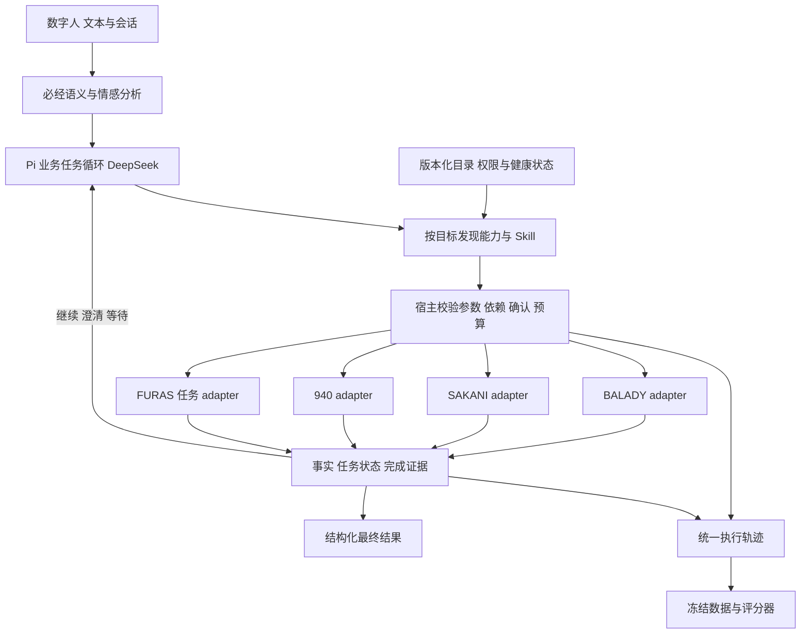

# 政府业务总入口 Agent POC 方案 DRAFT v0.4

日期：2026-10-09。业务范围：BALADY、SAKANI、940、FURAS。底座建议：Pi SDK + DeepSeek。

本次将 v0.3 的通用案件/维修/地理位置示例替换为四个指定业务域，保留原有情感与语义评测，增加具体能力目录、可运行模拟服务、工具规模实验及二次开发边界。推荐复用 Pi 的工具循环和插件接口，在项目中实现政府业务契约、能力发现和评分器；业务数量变化通过插件与目录处理。

当前已交付 16 个业务操作的目录、确定性 API/Agent 模拟服务及 10 项通过的自动测试。Pi 业务插件、真实 DeepSeek 调用、600 条语言数据和规划评测 runner 尚待实施；本文的准确率目标均为提案，没有模型实测成绩。

## 1. 业务映射和模拟边界

你的思路适合 POC：三个 API adapter 加一个独立 Agent adapter，足以验证单系统选择、跨系统依赖、澄清、任务续接及动态能力发现。后续真实后方数量与实现方式可能变化，主编排器只依赖能力契约。

| 逻辑系统 | 本 POC 的任务范围 | 官方公开资料与本设计的区别 |
| --- | --- | --- |
| BALADY | 地块规划、土地使用证书查询及用途变更申请 | 官方公开服务支持规划与建设许可。本 POC 的“土地使用证书”、变更字段及审批状态按用户指定场景自拟，不能当作已核验的官方产品/API。[建设许可](https://hafar.momah.gov.sa/ar/node/3497)、[规划请求](https://momah.gov.sa/ar/e-services/tlbaty-atmad-almkhttat-alkhast) |
| SAKANI | 住房支持条件、模拟资格判断、申请及付款状态 | 官方职责与住房支持相关。本 POC 将“政府补贴”收敛到住房支持，不推断真实资格门槛或金额。[资格核验](https://sakani.sa/services/check-eligibility) |
| 940 | 市政报事/投诉查询、联系历史、新建及重开 | 官方服务按分类登记市政报告，链接指向 Balady。因此独立 adapter 是本 POC 的逻辑边界，不能据此认定真实数据库或认证系统独立；重开也是自拟能力。[940 服务](https://hafar.momah.gov.sa/ar/node/3513) |
| FURAS Giant Agent | 委派投资机会筛选与建议任务，处理追问、等待、结果及取消 | 官方公开的是房地产及市政投资机会门户，包含浏览机会及投标旅程；未核实官方 Agent 接口。Giant Agent 为本 POC 的接入假设，建议范围是机会筛选及依据解释。[FURAS](https://furas.momah.gov.sa/ar/about) |

所有路径、身份、机会、状态和规则均为 `source_type=mock`。模拟预算过滤仅用于测试工具行为，不是投资分析或真实投资门槛。“提交申请”“重开投诉”“建议任务完成”各自有独立结果，不能被表述为批准用途变更、现场问题解决或投资已执行。

## 2. 首轮 16 个业务操作

三个 API 指三个业务系统。它们合计提供 12 个模拟 API 操作；FURAS 提供 4 个任务操作。宿主的目录发现、Skill 读取、用户澄清和最终结果提交是控制能力，统计时另列。

### BALADY：5 个

| Tool ID | Mock HTTP 接口 | 关键行为 |
| --- | --- | --- |
| `balady_planning_get` | GET `/balady/parcels/{parcel_id}/planning` | 返回规划用途和模拟规则版本；不能据此改变证书 |
| `balady_certificate_get` | GET `/balady/certificates/{certificate_id}` | 返回本人证书、当前用途和版本；越权拒绝 |
| `balady_change_validate` | POST `/balady/changes/validate` | 根据证书、目标用途及规划进行预校验；返回 validation ID、问题及规则版本 |
| `balady_change_submit` | POST `/balady/changes` | 需要有效预校验、参数绑定的 mock 确认和幂等键；仅生成申请回执 |
| `balady_application_get` | GET `/balady/applications/{application_id}` | 查询申请进度；区分 submitted、pending_review 与最终审批 |

提交时再次检查证书版本、规划规则及确认范围。模拟服务不会自动审批或修改证书。真实接入可以按后方契约增加审批查询、材料补充等工具，不让入口自行模拟真实审批决定。

### SAKANI：3 个

| Tool ID | Mock HTTP 接口 | 关键行为 |
| --- | --- | --- |
| `sakani_requirements_get` | GET `/sakani/support/requirements` | 说明 POC 的虚构支持规则及允许的场景结果 |
| `sakani_support_assess` | POST `/sakani/support/assess` | 根据预置 profile 返回 eligible、ineligible 或 needs_input，并保留缺失字段 |
| `sakani_request_get` | GET `/sakani/requests/{request_id}` | 返回本人申请和付款状态；under_review 不等于已获补贴 |

资格是确定性 fixture 的场景标签，不是从官方政策实现的规则引擎。缺资料与不符合资格必须分别测试，不能因用户情绪强烈而改变结论。

### 940：4 个

| Tool ID | Mock HTTP 接口 | 关键行为 |
| --- | --- | --- |
| `crm940_complaint_get` | GET `/crm940/complaints/{complaint_id}` | 返回投诉状态和处理记录；closed 不证明现场解决 |
| `crm940_history_get` | GET `/crm940/complaints/{complaint_id}/history` | 返回同一案件联系与处理历史，供重复联系核验 |
| `crm940_complaint_create` | POST `/crm940/complaints` | 在 mock 范围内新建市政报事或 BALADY 服务延迟投诉，要求对象和确认 |
| `crm940_complaint_reopen` | POST `/crm940/complaints/{complaint_id}/reopen` | 凭确认重开本人已关闭投诉，保留原历史；不声称修复 |

940 不因“生气”“拖太久”自动成为路由目标。单纯问 BALADY 进度仍是查询；明确要求投诉才进入相应路径。SAKANI 的资格异议和补贴办理不由当前 940 mock 承担。

### FURAS：4 个

| Tool ID | Mock HTTP 接口 | 关键行为 |
| --- | --- | --- |
| `furas_task_start` | POST `/furas/tasks` | 发送目标与筛选条件，返回 task ID、needs_input 或 pending |
| `furas_task_get` | GET `/furas/tasks/{task_id}` | 查询进度，完成后返回机会、筛选依据、引用及限制 |
| `furas_task_resume` | POST `/furas/tasks/{task_id}/resume` | 为同一 needs_input 任务补充条件，保留关联 |
| `furas_task_cancel` | POST `/furas/tasks/{task_id}/cancel` | 取消未完成任务，不把已完成任务改写为已撤销 |

首轮 FURAS 采用脚本化 Agent mock，具有确定性状态机和固定机会库。它不声称模拟 Giant Agent 的内部智能；它验证的是入口能否正确委派、追问、续接、处理等待和验证结果。当前实现支持 needs_input、pending、completed、cancelled；fixture 可注入 HTTP 失败。后续 adapter 另测试远端任务 failed、超时、无证据和不合规输出。

真实模型驱动的 FURAS 实验单独进行：独立会话与模型配置，只使用自己的机会工具；入口只看到任务契约，不展开其内部工具清单。父子任务共享关联 ID，分别设调用/时间预算，再汇总成本。远端结果不能指挥入口增加权限或执行投资。

## 3. 与业务接近的规划案例

以下中文是测试场景说明。语言评测的实际输入应使用阿语、阿英混合或英文，并独立复核自然度与参考标签。

| 用户问题 | 正确路径及业务断言 |
| --- | --- |
| “查一下我的土地使用证书现在是什么用途。” | BALADY certificate 查询即可；不调用其他域，不提交变更 |
| “把我的证书从住宅改成商业用途。” | 取得证书并预校验；缺对象先问对象；具备确认后提交申请。返回提交回执，证书仍保持原用途 |
| “变更申请 APP-MOCK-001 还没办完，先查进度，如果仍在处理就帮我投诉。” | 先 BALADY application；按实际状态决定是否进入 940 新建投诉；关联原申请。负面情绪单独保存 |
| “投诉已经关了，垃圾还在，这是第三次找你们；帮我重新处理。” | 940 complaint/history 分别核实关闭及联系；“垃圾还在”为用户当前主张；确认后重开，不能说已清理 |
| “我想知道住房支持资格，不是投诉。” | SAKANI assessment 或先查询条件；不因否定中的“投诉”调用 940 |
| “我想要一块地。” | 先区分住房用地支持、地块规划或投资机会；不能看到“地”就锁定 BALADY |
| “在吉达找适合咖啡馆的投资机会，并核对候选地块允许的用途。” | FURAS 委派筛选；条件不足则续接同一 task。取得候选地块后调用 BALADY planning；规划不符时保留冲突，不直接批准用途 |
| “补贴申请查一下，另外投资建议别继续了。” | SAKANI 查询与 FURAS 取消分别关联对象，保存两个子目标；可独立处理，不串用 ID |
| “服务真让人生气。” | 识别负面情绪；业务诉求不足时澄清，不自动生成投诉或投资任务 |
| “投诉里的坑已经填好，另一个位置现在有危险。” | 拆分历史已解决事件与新风险。风险分诊由宿主处理；不将旧案件查询结果当作新地点安全证据 |

参考允许多种合法执行路径和无依赖查询并发，要求真正的数据依赖成立。例如投资机会尚未返回 parcel ID 时，不能编造地块号执行规划查询。

## 4. 可扩展的运行设计



Skill 是领域说明和流程知识，Tool 是有契约的执行操作，Plugin 包含目录、Skill、Tool 与 adapter。建议首轮四个业务插件各有一个主要 Skill，名称见 [catalog.json](../poc_mocks/catalog.json)。四个系统属于目录配置，主程序中不写死关键词路由。

目录生产版至少包含：稳定 capability/tool ID、system ID、Skill ID、版本、适用/排除情境、多语言术语、输入输出 schema、必需字段、前置条件、读写属性、认证范围、完成证据、幂等、超时、健康状态与资源归属策略。本轮 catalog 是 mock 接口清单，尚不是包含全部字段的生产 manifest。

入口保留三类不同数据：用户原文及候选语义、系统事实与来源、程序管理的任务/动作结果。情感和 SA01–SA05 依然逐项绑定证据；SA 标签按定义适用，不能给每个投资问题强套五类市政事件。单个系统事实只核实对应主张。

扩展模块建议使用少量稳定接口：

```text
SemanticAnalyzer.analyze(messages, relevant_history, taxonomy_version)
CapabilityCatalog.discover(goal, actor_scope, snapshot, limit)
BusinessAdapter.execute(capability_id, typed_input, execution_context)
RemoteAgentAdapter.start / get / resume / cancel
EntryAgent.run(request, capability_snapshot, model_config)
RunRecorder.append(normalized_event)
Evaluator.score(case_reference, recorded_run)
```

这些是本项目接口提案，不是 Pi SDK 方法。身份、认证、确认和内部端点由宿主注入，不接受模型提供 actor、任意 URL 或凭据。新增业务插件通过契约检查后登记，新的请求使用新目录快照；执行前仍检查权限与能力是否已停用。

### 工具增多时的两层发现

先按每个子目标发现候选领域/Skill，再获取少量相关 typed tools；入口可因新的查询结果再次发现能力。多意图可以选多个领域，不能强行单选一个系统。先做关键词/术语与语义描述检索基线，是否增加 embedding 或 reranker 由检索实验决定。

宿主显式提供 `catalog_search`、受控 `skill_read(skill_id, version)`、澄清和 `submit_result` 等控制能力。发现后由宿主更新获准工具集合，并提供相应结构化工具声明。不能用一个无约束 `execute(any_id, any_json)` 把实际能力数藏在参数里，然后声称工具数量恒定。

Skill 可见、检索到、已装载、被用于正确执行是四种不同观察。若由宿主自动注入 Skill，指标称“Skill 检索/装载召回”，不称模型主动选择准确率；若模型显式选择 `skill_read`，则可以评分该选择。精简候选也不能替代调用时授权。

## 5. 基于 Pi 的二次开发

不 fork 上游核心，使用固定发行版本的 SDK、业务 extensions、typed tools 和事件。先验证发布包与已读源码 ref 的兼容性，再锁定依赖；API 差异由 `harness/pi` adapter 吸收。[Pi SDK](https://github.com/earendil-works/pi/blob/6fb2e7815167e6b19006fc526d1a5d0f5f998787/packages/coding-agent/docs/sdk.md)

| Pi 可直接复用 | 本项目负责 |
| --- | --- |
| 模型接口、会话、工具循环、扩展注册、流式事件和脚本 provider | 语义情感契约、四域目录、发现、执行政策、业务 adapter、FURAS 任务续接、评分器 |
| 动态更新可见工具 | 目录版本、停用/撤权、按目标检索、真实调用时权限检查 |
| Tool 参数约束与返回事件 | 后方事实校验、确认与幂等、任务完成证据、结构化最终结果 |

关键开发动作：

1. 构造受控 ResourceLoader、内存设置和独立会话，只加载明确指定的业务资源。普通文件、bash、edit、write 不进入市民工具集合。[受控加载示例](https://github.com/earendil-works/pi/blob/6fb2e7815167e6b19006fc526d1a5d0f5f998787/packages/coding-agent/examples/sdk/12-full-control.ts)
2. 通过公开 `registerTool`/SDK custom tools 封装 16 个业务操作。使用明确工具名白名单；当前读取实现的 `tools: []` 会过滤自定义工具，不能当作仅关闭默认编码工具。
3. 将身份、前置条件和预算放在宿主与 execute 入口；hook 记录、拦截和规范化事件。Skill 不承担访问控制。
4. 提供受控 Skill loader；不为读取领域说明重新开放任意文件读取。新增 Skill 的格式是业务内容，不是新编排代码。
5. 用 typed `submit_result` 提交业务结果，宿主核对完成证据；没有有效提交则记录未完成。最终自由文本不能成为唯一办理成功依据。
6. 将 Pi 事件转换为稳定 trace，记录 case/task/subject、operation、参数、结果、开始/结束、状态转移、版本和错误类型；评分器不读取 Pi 私有对象。
7. 若 Pi 适配实验失败，以相同项目接口切换 DeepSeek Harness 或 Deep Agents，复用业务插件契约、mocks 和评分器。底座可替换不代表不需重写适配层。

推荐的后续代码结构：

```text
apps/entry-service/             渠道与会话宿主
packages/contracts/            语义 能力 任务 轨迹 契约
packages/semantic/             情感与 SA 分析
packages/catalog/              能力检索与 Skill 装载
packages/harness/pi/           Pi SDK 适配
packages/models/               供应商配置及输出能力包装
plugins/balady/                 Skill manifest typed tools adapter
plugins/sakani/
plugins/crm940/
plugins/furas-agent/
poc_mocks/                     已实现：本地 Python 模拟服务
evaluation/                    待实现：用例 runner 评分 报告
tests/                         已实现：模拟服务回归
```

Mock 服务使用 Python 标准库是为了独立于 harness 运行，没有要求主 Agent 也使用 Python。首轮所有 mock 都使用 JSON/HTTP，验证业务接口与任务生命周期的差异；SOAP/MCP/A2A 等协议适配按真实接口需要再加。本轮不据此声称已验证那些协议。

Pi 和 DeepSeek Harness 的优缺点与固定源码依据继续见 [v0.3](government-entry-agent-poc-v0.3.md) 及 [Pi 研究](research/semantic-poc-harness-pi_20261009.md)。Pi 首选来自扩展成本判断，没有同场性能排名；DeepSeek Harness 仍需处理 developer preview 的升级风险。

## 6. 冻结数据与代表性

原计划约 600 条语义情感记录和 60 条确定性异常用例继续保留，定义、家族切分、证据、Codex/Gemini 候选生成与独立复核方式见 [v0.2](semantic-analysis-poc-v0.2.md)。重新分配其中普通咨询与多意图场景到四个新业务域，保留五类 SA 正反例及语言难例，发布新的数据版本。

新规划集目标 80 条，不替代原语言集：

| 主场景组 | 数量 | 重点 |
| --- | ---: | --- |
| 三个 API 单域任务 | 24 | 每域 8 条，查询/执行/缺字段/近似工具区分 |
| FURAS 生命周期 | 12 | 委派、追问续接、pending、无机会、取消、失败、无证据 |
| 跨域依赖 | 12 | BALADY→940、FURAS→BALADY、独立目标并发 |
| 歧义与多意图 | 12 | “土地”“支持”“机会”、否定中的投诉、指代与两个对象 |
| 权限、故障和目录变化 | 12 | 403、404、503、停用、陈旧规则、幂等、任务预算 |
| 语言对规划的影响 | 8 | 阿语术语、沙特表达、混合语言、讽刺但无投诉诉求 |
| 合计 | 80 | 数量为实施目标，尚未生成并裁定 |

建议家族分组后约 32 开发、24 固定回归、24 保留评测。目标数量可能按完整家族调整。每条应有独立运行输入、系统初态、目录快照、允许路径、对象关联、必需依赖、禁止动作、可接受澄清与最终状态断言。参考及 fixture 内部确认信息不进入模型上下文。

Codex 按场景蓝图生成候选；Gemini 可独立复核语言与标签，但不看到生成器参考。两模型一致仍不是确认 gold。没有本地阿语评审时，机器参考成绩标为 provisional；后续真实脱敏样本单独验证分布代表性。

## 7. API/工具数量实验

固定原任务和正确能力，增加合法但无关或容易混淆的候选，测试 16、32、64、128、256 个业务操作。宿主控制工具及 FURAS 内部工具数另报。256 级是压力实验，受所选模型真实上下文与工具上限约束；不支持时记录为 capacity/contract failure，不强行截断后仍称全量实验。

新增能力应有可执行 mock 契约和独立用途，例如许可材料查询、住房资料补充、报事分类查询、投资投标材料解释；尽量构造“申请进度”跨域同名语义等近邻。不要仅把同一接口改名复制 240 次。新增能力若形成新的合法解法，应更新并冻结允许路径，不能把合理选择判为错。

| 实验策略 | 模型看到什么 | 目的 |
| --- | --- | --- |
| A 全量声明 | 当前目录全部业务工具及相同 Skill 信息 | 建立工具数量增长的基线 |
| B 两层发现 | 领域/Skill 候选，再每次 4/8/16 个工具；允许再次发现 | 测量检索节省上下文的收益及漏检损失 |
| C 正确候选注入 | 评分侧提供包含所需工具的候选，运行输入无答案 | 仅作诊断，区分规划瓶颈与检索瓶颈，不作为产品成绩 |

先按声明数量比较，再做 token 预算相近的对照；工具描述长度、语言与清晰程度保持约束并记录实际 token。同一用例/fixture/模型配置成对比较，目录顺序至少用 3 个固定 seed 打乱；seed 是目录顺序，不假定供应商支持模型随机种子。报告包括失败、拒答、超限和耗尽预算的运行，不能只筛选成功样例。

日常不跑完整矩阵：先做 8 条 smoke × 3 个数量级（16/64/256）× A/B，两策略共 48 次用例运行；这是待实现的 live 实验规划。里程碑可跑 24 条固定规划回归 × 5 级 × A/B × 3 个目录顺序，共 720 次；诊断 C 只用于失败小集。运行前限制总请求、token、时间及费用，报告因预算未跑的覆盖。

四系统目录只包含四个主要 Skill，不能据此得出大量 Skill 时的结论。另做 Skill 数 4/8/16/32 的独立实验，将较大系统拆成用途明确的子 Skill，再加入相近领域；初期固定工具总数与有效任务。Skill 数与工具数的影响分别报告。

## 8. 准确率、精确率、召回率与任务完成

“准确率”需要明确观察对象；系统路由、检索、调用与办理结果分别评分。评分使用执行轨迹、系统状态与参考依赖，不评价规划 prose 是否与参考逐字一致。

| 指标 | 定义与用途 |
| --- | --- |
| System routing exact accuracy | 用例选中的业务系统集合是否等于某条允许路径的系统集合；歧义用例可要求先澄清而不是硬选系统 |
| Skill selection P/R/F1 | 显式选择/装载的 Skill 与参考比；宿主自动注入时改报检索及装载指标，不推断模型使用情况 |
| Discovery Recall@K | 当前决策阶段参考所需能力被候选覆盖的比例；多目标报告逐阶段及全流程覆盖 |
| Complete candidate coverage | 所有必需决策阶段的候选是否足以构成完整允许路径，防止平均 recall 掩盖一个关键漏检 |
| Tool selection P/R/F1 | 有效目标匹配 TP、无关/错误目标 FP、未覆盖必需动作 FN；分别 micro 与逐工具/逐域 macro |
| Tool/argument correctness | 工具是否合适与参数/对象是否正确分别报告；对错对象调用同名工具仍算错误执行 |
| Task success rate | 必需目标、前置依赖及最终业务断言全部满足；多目标另报每目标覆盖，不能用部分完成替代整体成功 |
| Clarification / abstention | 必需追问召回、无必要追问率、越过缺字段行为、合理未完成；支持拒答不能被当作自动满分 |
| Evidence / truthfulness | 引文支持、系统事实关联、是否将申请回执改写为批准、是否伪造任务结果 |
| Efficiency / stability | 无关调用数、重复调用数、总模型调用、p50/p95、token/费用、关键用例重复的结果变化 |

对某条允许路径：`Precision = TP/(TP+FP)`，`Recall = TP/(TP+FN)`，`F1 = 2PR/(P+R)`。先按 fixture 和最终状态确定适用路径，再匹配 `(operation, subject, subgoal)` 的动作项；同一工具处理两个对象是两个任务项。可选合法步骤不强制增加 FN，重复调用不增加 TP，另计效率；被拒绝的无关调用也计选择 FP，实际越权成功另外统计。备选路径由参考显式列出，评分器不得在运行后随意放宽。

宏平均使用固定工具/域全集和支持样本数。无正例的分组单列 FP，零分母标 N/A；未裁定参考单列，不混入正式精确率。逐标签 P/R 报区间，配置差异用相同场景家族成对比较。

原有情感 Macro-F1、情绪标签 P/R/F1、SA01–SA05、证据及语言分组继续单独报告。建议探索目标沿用情感 ≥0.85、情绪 ≥0.80、各 SA 的 P/R ≥0.85、当前风险召回 ≥0.95（至少 30 正例并报告区间）。新增目标建议：系统集合准确率 ≥0.90、Tool P/R ≥0.90、发现 Recall@8 ≥0.95、任务成功率 ≥0.85。它们是待协商的技术目标，不是已取得或生产验收指标。

在小样本上“零个越权执行、零个伪造完成”作为测试必查断言；零观察不能证明部署风险为零。参数、证据、预算和幂等失败全部导出 case 轨迹，按语义→检索→选择→政策→adapter→远端结果定位。

## 9. 快速回归与模型替换

| 层次 | 运行内容 | 能证明什么 |
| --- | --- | --- |
| 已实现 mock 自动测试 | 标准库测试 + 固定 API/Agent 状态 | 16 路由及关键状态、归属、确认、幂等、故障和 HTTP 行为；没有语言准确率 |
| 待实现离线 Agent 回归 | Pi 脚本模型或重放 + 确定性 mocks | 业务插件、目录、解析、状态、预算及失败响应接线 |
| 待实现 live 回归 | 真实 DeepSeek + 冻结语言/规划输入 + 相同 mocks | 模型语义、Skill/Tool 选择、澄清、依赖及任务正确性 |
| 独立 FURAS LLM 实验 | 总入口和远端 Agent 各自真实模型 | 两级 Agent 不确定性、等待、成本和证据质量；结果单列 |

现在可以执行：

```bash
python3 -m unittest discover -s tests -v
python3 -m poc_mocks.server --port 8765 --trace-out artifacts/mock-trace.json
```

启动服务后使用固定路径调用，例如：

```bash
curl -H 'X-POC-Actor: citizen-a' http://127.0.0.1:8765/balady/certificates/CERT-MOCK-001
```

后续统一评测 CLI 的设计如下，尚未实现：

```text
poc test --offline
poc eval --model-config configs/models/deepseek.yaml --suite semantic-regression
poc eval --model-config configs/models/deepseek.yaml --suite planning-regression --catalog 16 --strategy layered
poc eval --matrix configs/tool-scale.yaml --max-cost <budget>
poc compare --baseline artifacts/baseline --candidate artifacts/candidate
```

每次修改 Skill、工具描述、规则、harness 或模型配置：先跑离线层，再跑对应 smoke 和固定回归；升级模型或里程碑再跑保留集和数量矩阵。实时质量测试必须真正调用新模型，不能读取旧模型重放来评价升级效果。

每次报告保存：数据/fixture/目录版本与 hash、代码与 harness 版本、Skill/提示版本、provider 与请求/返回 model、调用日期、模式、预算、用量、原始与标准化轨迹、逐例评分和 baseline 差异。API 凭据通过宿主配置引用，不写入报告。

模型配置分别支持语义 analyzer 与 planner；比较整套 LLM 更换时二者一起切换，定位时单独切换。FURAS 先固定脚本，避免同时改变两个 Agent 后无法归因。供应商结构化输出、工具上限和错误差异由模型/harness adapter 包装，业务 gold 与规则保持冻结。

## 10. 实施顺序与风险

当前完成模拟底座。下一阶段先做 Pi 适配验证：明确依赖版本、受控工具/Skill 加载、一个 API 与 FURAS 的实际 DeepSeek 任务、结构化结果及 trace；通过后接满 16 操作。

随后完成语义/规划数据、评分器及 baseline，再跑工具/Skill 数量实验。整体约 10–15 个工作日仍是 v0.3 的粗估，依赖工程投入、模型配置和参考复核；并非本轮已投入天数或保证工期。

主要风险有：目录描述重叠导致误选；检索丢失必需能力；情绪被当成办理意图；对象及 task ID 串用；远端建议缺证据；多轮循环与成本累积；插件版本变化与默认编码能力暴露。对应设计是可检索合同、必经语义模块、明确任务对象、执行检查、预算及分层评分。

首轮统一 JSON mocks 不代表真实接口集成复杂度，合成阿语不代表线上分布，脚本 FURAS 不代表真实 Agent 推理能力。POC 的判断依据应是逐例证据和错误分布，并在更换 LLM 后用同一契约重新验证。

## 本轮文件

- [能力目录](../poc_mocks/catalog.json)：16 个操作、Skill 对应、参数类型和路径。
- [模拟服务](../poc_mocks/server.py)、[基础 fixture](../poc_mocks/fixtures/base.json)、[运行说明](../poc_mocks/README.md)。
- [10 项回归测试](../tests/test_mocks.py)：包含全部 16 操作的工作流覆盖及 HTTP 测试。
- [官方业务资料](research/government-domain-mock-evidence_20261009.md)、[原评测计划](semantic-analysis-poc-v0.2.md)、[开源底座评估](government-entry-agent-poc-v0.3.md)。
