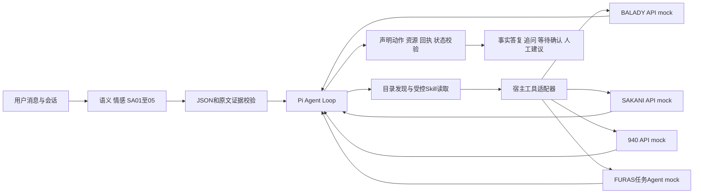
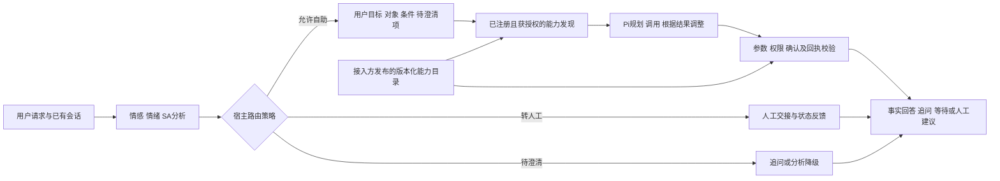

# 政府业务入口 POC V1：实现与选型

> 历史记录：本文件保留 V1 实现及后续设计讨论。“尚未实施”和旧 intents 耦合描述针对 V1 快照。2026-10-09 已完成 V2 模块拆分、开放能力目录和情绪路由，当前实现见 [V2](government-entry-agent-poc-v2.md) 和 [README](../README.md)，实测见 [V2 最新报告](../reports/latest-v2.md)。

2026-10-09。V1不接知识库，已具备实施和技术验证条件。采用Pi SDK作为Harness，DeepSeek作为LLM，以四个业务插件实现三API和一Agent mock。

## 名称与选择

Harness是管理模型调用、工具循环、上下文与运行控制的框架类别。Pi本身就是Harness；若指具体的DeepSeek Harness，它与Pi才是候选项目。

| 项目 | V1判断 | 后续使用条件 |
|---|---|---|
| Pi SDK | 首选。嵌入Node、受控工具/资源及DeepSeek调用已实际验证，固定1.1.0与lockfile | SDK+业务插件，当前未fork上游 |
| DeepSeek Harness | 插件路线的候选；当前未做同等规模真实评测，不能据名称判断优劣 | 另验证嵌入、状态、模型替换和相同冻结集 |
| LangGraph | 可表达动态路由及包含Agent Loop，适合持久化、人工中断和恢复 | 出现跨重启长任务或可靠人工接管要求时选编排层；V1无需叠两套框架 |

依据：[Pi固定版本SDK](https://github.com/earendil-works/pi/blob/abe508e1b89912adde45528136c3221eb69acdd7/packages/coding-agent/docs/sdk.md)、[DeepSeek Harness](https://github.com/deepseek-ai/deepseek-harness)、[LangGraph overview](https://docs.langchain.com/oss/python/langgraph/overview)。这是本POC的实施判断，并非完整框架性能排名。

## 运行结构



Pi提供循环，规划质量仍取决于模型、工具说明和会话。当前`analyzer.mjs`处理原文、sentiment、7类emotions、SA01–05，以及固定四系统POC的16类intents，最多一次JSON/证据修复。这16类是闭集实验标签，不是未来所有政府服务的意图全集；当前运行代码仍将它们用于goal schema和完成校验，尚需按下节修订才能支持开放接入。exact-span存在校验不证明语义支持正确，情绪不改变操作权限。

`entry-agent.mjs`使用受控ResourceLoader及typed-tool白名单，不加载shell或任意文件工具。四个 `plugins/*/SKILL.md`提供流程说明；身份与执行约束由宿主代码检查，技能文档不是授权凭据。flat暴露全部业务工具，layered先发现候选，再激活typed tools续接同一Pi会话。

## 设计修订：持续新增系统，不维护中央业务意图全集

2026-10-09补充。此节是扩展版设计，尚未实施；已保存的V1实测与审查对应原固定四系统代码。16类intents用于闭集POC有助于定义可检查的动作，但若将它们作为长期执行门槛，新增未覆盖业务必须修改中央枚举、提示、完成映射与评分器，不能达到插件独立接入的目标。

当前耦合位置明确：`contracts.mjs`中的INTENTS决定分析schema；`entry-agent.mjs`把同一枚举放入goal schema，并用expectedOperation、subjectPrefix、subjectFields及固定skills表检查执行。因此当前catalog扩到256个模拟工具，不等于已验证任意新增系统可以独立完成任务。

扩展版将稳定的语义分析与业务能力选择分别处理。情感、情绪和SA指标按其语义协议维护，不因新增接口自动增加分类；用户目标以原文证据、自然语言描述、对象/条件及待澄清项表达。业务操作从当前授权的能力目录中发现，再交给Pi循环规划和执行。能力目录保存工具说明，V1仍不接政策知识库。



| 信息 | 所有者与用途 | 新增系统时的变化 |
|---|---|---|
| 情感/情绪/SA语义定义 | 入口分析协议，用于服务感知与评测 | 原定义继续使用；确有新增语义需求时另做协议版本 |
| 用户目标 | 从每次请求和会话提取，允许多个目标与未确定对象 | 无需新增中央业务enum |
| 情绪到处置路径的映射 | 宿主版本化路由策略，决定自助/人工/澄清 | 按业务配置修改并独立回归；Agent不能自行覆盖 |
| capability_id、输入/输出schema及副作用 | 接入方发布、宿主审核注册的插件契约 | 新增命名空间及能力版本 |
| 资源字段、依赖与完成条件 | 插件内受信任的声明或专用validator | 随能力发布，模型无权自定义验收规则 |
| 参数、授权、确认、幂等、预算与通用回执规则 | 宿主执行协议 | 现有规则复用；出现新执行协议时扩展adapter并回归 |

例如新增收费查询系统，接入方注册`fees.invoice.lookup@1`，提供“查询账单金额与状态”的多语言说明、invoice_id schema、只读属性、资源所有权要求，以及权威返回状态的解释。用户说“我这笔费用到底交没交？”时，Agent检索相关能力，发现缺少账单信息便追问，信息齐备后查询。入口不需要增加invoice_status这一中央意图类别，也不要求用户知道后方系统名称。

用户目标不是可执行授权。Agent只能引用目录中实际存在、当前获授权的capability_id；对象有歧义时继续澄清，目录没有能力时说明无法办理。系统接入方仍需提供服务契约及代表性用例，可从OpenAPI辅助提取字段，但政策含义、授权和完成条件需业务确认；不能要求其穷举所有自然语言表达，也不能承诺完全零配置接入。

完成校验必须保留并迁移：用插件内的受信任完成契约，验证所选操作、资源、参数、依赖与权威回执；不能简单删掉expectedOperation检查，也不能让模型提交任意operation列表便判定完成。例如“校验土地用途变更可行性”的回执不能完成“提交变更”，这一约束移入BALADY能力契约。选错能力却取得成功回执，仍可能误解用户目标，需独立端到端用例检验，写操作还需绑定明确提案的可信确认。

技能说明、能力元数据和后方结果都不能覆盖宿主权限。每个会话固定目录快照和契约版本，新系统经审核发布后可供新会话发现；进行中的任务继续使用兼容的已绑定版本，避免更新改变待确认动作或完成语义。目录检索的多语言表达、相似能力混淆及候选召回必须单独验证，不能将当前英文关键词索引视为已完成的通用能力发现。

## 情绪分析与任务Agent的独立替换

修订后的目标流程分为情绪分析、路由策略、用户目标理解与任务循环、受控执行。情绪分析输出5类sentiment和7类可多选emotions，并可保留独立SA指标；目标理解输出自然语言目标、对象、条件和待澄清项。任务Agent仅在宿主允许自助后基于已注册能力规划、执行并按回执调整，不要求先生成完整且不可变的计划。没有可执行诉求时直接回应；缺信息时追问，写操作等待可信确认，工具不可用或失败时按契约处理。

这两个分析方向都读取原始请求与必要会话上下文。任务Agent不能仅从情绪标签推断业务目标。模块可独立替换，但运行依赖由路由策略决定：若负面情绪要求直接转人工，情绪分析与路由必须完成后才能启动业务Agent。可选择并行提取纯文本目标用于交接，但不得提前调用业务工具。逻辑独立不要求固定两次LLM调用：实现可采用分别调用或一次调用分段输出；共享调用时故障与版本仍可能耦合。需要分别选择模型、独立超时或降级时，分别调用更容易维护与验证。

以下为建议的模块接口，尚不是现有CLI或SDK的新函数：

```text
EmotionAnalyzer.analyze(conversation) -> EmotionResult
RoutingPolicy.decide(emotion_result, session_state) -> RouteDecision
TaskAgent.handle(conversation, task_state) -> TaskResult
```

EmotionResult采用版本化的分类、原文证据和外层分析状态；正常结果包含sentiment/emotions/SA字段，分析失败需明确记录，不伪造为中性。TaskResult采用版本化的目标、状态、缺失字段、已执行操作及回执，记录能力目录快照。模型client通过依赖传入；TaskAgent构造时接受目录与受控executor，由宿主提供身份、确认与执行检查。

| 替换或扩展 | 保持不变的接口 | 必须重新验证的内容 |
|---|---|---|
| 情绪模型、提示或分类算法 | 同一EmotionResult语义与schema | 情感/情绪/SA参考集、证据与多语言表现，以及使用这些结果的对话策略 |
| 增加/改变情绪标签定义 | 新EmotionResult协议版本 | 标注定义、对应新参考集、评分、消费方兼容；旧数据不覆写 |
| 任务模型、提示或Harness实现 | 同一任务与执行契约 | 能力发现、工具选择、参数、补信息、确认、回执、任务连续性与失败处理 |
| 新增系统/工具/Agent | 既有宿主执行协议 | 插件契约及下节的分层回归；新执行方式可能需要新adapter |

独立模块可分别配置模型/provider/提示版本，并在报告中分别记录。改变内部实现且保持输出契约，可复用下游模块；改变标签含义、输出协议或执行语义，仍需迁移与回归。更换Harness还需验证会话、取消、工具与恢复协议，不是只改型号配置。

当前讨论采用情绪决定执行路径的模式，分析结果与路由判定为执行前置条件，未得到允许自助的判定时业务工具默认禁止。情绪只调整话术的业务可另选非阻塞模式；两种模式需明确配置，不能在依赖情绪的规则下默许分析失败仍自动执行。权限、确认和业务前置检查继续由宿主执行。

当前实现已有`analyze(client, input)`与`EntryAgent`两个入口，但分析仍包含固定INTENTS、规划schema仍依赖同一INTENTS、CLI用同一个`--model`参数配置两者，live provider固定DeepSeek。扩展实施应先拆除业务枚举耦合，再提供独立模型/provider配置与版本化结果协议。本节是设计目标，不表示当前运行代码已经完成独立热替换。

## 情绪影响执行路径：负面转人工

2026-10-09补充设计。按“负面直接转人工、正常交给Agent”的业务规则，先用情绪模型产生分类和证据，再由宿主的版本化RoutingPolicy决定执行路径。这里示例用sentiment=negative表示负面；若业务还要求anger等emotion触发人工，应显式增加规则，不能把全部情绪标签自动等同负面。模型负责分类，宿主规则负责处置，Pi负责获准后的规划执行。

| 分析结果 | 示例路由 | 自动业务工具 |
|---|---|---|
| valid且sentiment=negative | human：立即发起人工交接 | 禁止 |
| valid且sentiment=positive/neutral | agent：进入Pi任务循环 | 仍需通过参数、权限、确认等执行检查 |
| valid且sentiment=mixed/undetermined | clarify：澄清或按业务配置转人工 | 暂停 |
| 分析超时、结果无效或失败 | 受限重试；失败后按配置转人工 | 禁止默认当作正常 |

RouteDecision记录action、reason、policy_version和当前消息/会话版本。执行器每次调度工具时检查当前宿主判定；调用人工交接connector走人工路径的专用契约。路由允许自助只是业务执行条件之一，不能替代工具授权，也不能由模型在提示或工具参数中自行改为允许。

“识别目标”与“允许执行”分开。为了人工接手，可从原话提取诉求、对象及已知信息，打包分类、证据、既有任务状态和回执；这不授予业务调用权限。V1优先采用串行情绪分析→路由→Agent/人工分支，避免为了并行优化提前查询个人状态、创建投诉或启动FURAS任务。

每条新消息重新分析并按会话状态决定路径。自动流程中途转人工时，宿主暂停后续工具调度、失效旧路由放行，记录已发生的操作与未完成任务；已发出的请求或已提交操作不因转人工自动撤销。人工作业或交接中的会话不会仅因下一句话变中性就自动返回Agent，恢复自助须通过明确的会话转换规则。

人工路径需要实际接入渠道才能完成转接。排队、接通和失败分别记录，不将“判定应转人工”说成“人工已接通”。接入不可用时告知转接未成功，提供已配置的人工渠道并保存任务，不悄悄继续自动办理。当前POC无人工connector，仍只能推荐人工；可以新增协议mock检验队列/接通/超时状态，模拟结果须明确标记。

此需求需要分开验证情绪分类、确定性路由规则和端到端执行：负面人工场景应有零自动业务dispatch，正常场景维持任务正确性，mixed/undetermined/分析失败不能绕过规则，转人工不可用或中途切换应保留任务状态。报告增加转人工P/R、错误自动执行率、转接状态及等待时长，区分分类错误与策略/执行错误。引入新业务策略后新增policy版本和对应测试参考，保留旧80例及其原策略成绩，不能宣称旧通过率已覆盖新路由。

这层策略不会要求更换Pi；情绪模型、路由规则、任务Agent与执行adapter仍可各自替换。新增策略须验证完整处理链；当前本节仅设计修订，尚未实现负面必转人工的运行行为。

## 新增系统时的回归范围

当前代码若修改INTENTS，分析输出、goal schema、提示与评分均可能受影响，应跑600语义、80规划、60工程的全量已发布集；若修改标签含义，须新增数据/协议版本并保留原参考，跨版本分数不可直接当作模型能力变化。

扩展版无需为每个业务修改中央enum，但仍需回归：

| 变化 | 日常验证 | 发布验证 |
|---|---|---|
| 新增普通能力/系统 | 新能力契约、成功/缺字段/失败场景、相似旧能力混淆、多目标组合及通用执行控制 | 全量已发布回归集与完整新目录快照，确认旧能力没有选择退化 |
| 调整全局模型、提示、检索排序或执行协议 | 对应单元/契约测试及开发集 | 全量已发布回归；重要质量决策另外使用新的独立盲测集 |
| 调整语义标签或业务完成含义 | 版本化参考与独立业务裁定 | 对应新协议全量评测，并保留历史版本结果 |

新增能力会改变全局候选竞争，因此局部通过不能证明旧系统完全不受影响。分层回归用于更快定位问题，发布时全量回归继续保留。新增场景至少覆盖同名不同系统、隐式目标、表达改写、补信息、多轮改意、多个对象、查/办混淆、未知服务、权限与后方失败。

未来业务评测以合法能力/动作集合、操作与资源组合、目标覆盖、各轮状态及真实后方结果为参考；允许合法替代执行路径，同时记录发现召回、工具选择P/R、任务通过及错误执行。旧16类intent F1保留为闭集历史指标，不再充当开放业务全集的准确率。情感/情绪/SA继续按独立语义协议评测。

## 执行与完成

write先产生宿主proposal，可信确认只绑定上一轮单一精确提案。actor、case、确认token和幂等键由宿主注入；拒绝/取消清提案。提交后响应丢失按原key重试一次；内存缓存不构成生产跨进程exactly-once保证。

FURAS保留task_id，多轮needs_input用resume，pending每轮最多3次get，取消作用原task。回执submitted/open/reopened/under_review及Agent completed不会变成政府批准、实际维修、付款或投资执行。

completed子goal须有成功回执，满足声明intent的操作及明确资源字段；BALADY submit按validation追溯certificate。多资源可拆多个goal。宿主验证声明动作/资源自洽，intent仍由模型提出，所以自然语言全部目标是否被正确理解/覆盖仍靠独立端到端标注评测，不能由schema形式证明。

用户结果暂由宿主从实际回执生成事实JSON，模型话术保存为内部draft待审核。`completed`表示声明任务执行完成。人工仅recommended，`handoff_transferred=false`；V1不含数字人呈现层、实际人工渠道或跨进程恢复。

## 回归与替换

600语义、80规划、60工程分开统计。工程faux脚本通过率不称模型准确率。每case独立后方，输入/参考物理分离，oracle不给模型。评分检查操作、参数、依赖、各轮状态、确认、真实mutation和Agent状态；分别记录proposal/dispatch/host_guard，以及有完成候选被拦截的用例数。这个计数不能解释为模型首次答复的精确误报率，最终通过也不等于首次判断正确。

保留每次报告、review与数据修订。参考错误先独立查契约再改版本；真实模型错误留在报告，不能改gold追模型。工具规模为16/32/64/128/256×flat/layered小样本配对技术实验，不是统计排名；四个Skill未扩容。扩展工具为不同虚构product/action的干扰项，不等于真实256API接入验证。

更换DeepSeek型号直接CLI重跑冻结集。换供应商需实现模型client/Pi provider配置并重新探测JSON、tool_choice和取消兼容；业务适配器与评分器沿用。若后续引入LangGraph，应处理持久化/长任务/人工中断边界，保留这些业务契约。

生产验收还需要母语与业务专家审核ontology、真实脱敏数据、API/认证/审批契约、真实远端Agent、持久化恢复和实际人工转接。合成评测与工程通过支持技术POC，不替代这些依赖。
