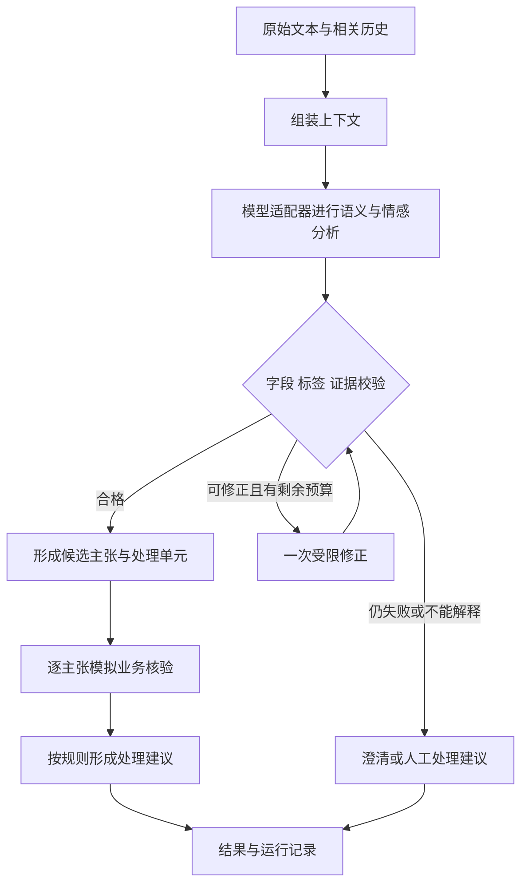

# Semantic Analysis POC 技术验证方案 DRAFT v0.2

日期：2026-10-09。状态：实施提案，尚无模型实测结果。

本 POC 验证市政服务文本中的情感、情绪、意图与业务事件识别，并提供更换底层 LLM 后可以复用的自动回归流程。首轮使用 DeepSeek API 和 LangGraph，业务系统使用明确标记的模拟数据。核心交付是稳定的数据契约、具有关键场景覆盖的测试集、可重复的评测流程和能定位错误的报告。

设计来源：[Semantic Analysis 架构设计 DRAFT v0.1](https://chatgpt.com/space/page_4abe69191c7c8191a25c66ae9013e8e2)。当前条件是没有 Qwen 和 HiAgent 平台，可配置 DeepSeek API；真实业务接口、脱敏业务样本和本地阿语评审资源尚未到位。技术能力依据见[官方资料与研究记录](research/semantic-poc-v0.2-evidence_20261009.md)。

## 可行性与范围

该方案可以开展技术验证。LangGraph 承担上下文组装、流程状态、条件路由、有限重试、业务查询和降级处理；字段验证、原文证据定位、业务规则和评测器由应用代码实现。这样可以验证原设计中由 HiAgent 承担的编排职责。未来迁移到 HiAgent 时，仍需要单独验证该平台的接口、权限、持久化和运行行为。

DeepSeek 首轮承担语义与情感解释。模型名称、模式、超时和输出策略均以配置提供。后续 Gemini、Qwen 或其他 LLM 经同一分析接口接入，复用测试集与评测器；供应商能力差异由适配器处理，阿语效果和语义标签仍需重新测试。

POC 的情感结论描述文本中表达出来的态度与情绪。语音声学情绪、真实个人心理状态和生产效果验收另行验证。

| 验证对象 | 首轮可完成的工作 | 结果用途 |
| --- | --- | --- |
| 编排与模型替换 | DeepSeek 和 Fake/Replay 两个适配器；相同契约与异常分类；后续接入第二个真实模型 | 验证调用流程可复用。Fake/Replay 无法证明第二个真实模型的能力或效果 |
| 语义与情感 | 合成样例、公开研究语料补充、标签与证据评测、分组错误分析 | 技术探索与相对回归；合成样例成绩不等于真实业务准确率 |
| 业务核验与处理 | 模拟案件状态、维修历史、权限、超时与冲突；逐主张保留核验结果 | 验证事实与模型主张分离，以及明确的处理分支 |
| 自动回归 | 离线确定性测试、真实 API 评测、版本差异报告 | 每次修改配置或更换模型时快速识别退步 |

## 识别对象与输出契约

保留原设计的 SA01–SA05：关闭后仍未解决、重复联系、感知延迟、潜在安全隐患、报告修复后复发。它们描述业务事件，不能直接代替情感标签。

| 输出 | 首轮定义 | 约束 |
| --- | --- | --- |
| 情感倾向 sentiment | positive、negative、neutral、mixed、undetermined | mixed 表示有证据的相反态度；undetermined 表示无法可靠判断，二者不能互换 |
| 表达的情绪 emotions | 满意、感谢、沮丧、愤怒、担忧、失望、困惑；允许多选 | 没有明确情绪表达时可为空；每项绑定证据。相近标签须有定义和例外条件 |
| 情绪强度 intensity | 无、轻微、明确、强烈四档 | 使用标注规则中的语言锚点；作为探索项，不以模型自报分数解释正确概率 |
| 情感对象 target | 服务、处理结果、等待、系统使用、其他或不明确 | 区分“感谢坐席但不满结果”；服务或案件对象可分别记录 |
| 意图与实体 | 查询、争议、报告、跟进等意图；案件号、地点、问题类型等实体 | 多意图分别关联事件与证据；原始值和规范化值分开 |
| 业务指标 indicators | SA01–SA05，可多选 | 保留排除条件、否定和时间；感知延迟不等于 SLA 违约 |
| 证据与歧义 | message_id、speaker、原文 quote、证据引用、缺失项、歧义 | 客服用语、第三方引语和历史情绪不能误当成市民当前情绪 |
| 会话变化 trend | 升高、稳定、缓和、无法判断 | 只在有足够且相关的多轮证据时返回；保留当前轮结果，不用历史平均值覆盖当前态度 |

首轮主要评测情感倾向、各情绪标签、五类业务指标、意图拆分和证据。强度、情感对象和趋势分别报告探索结果，避免用一个总分掩盖它们尚不稳定的定义。

统一的模型分析接口建议为 `analyze(input, context, taxonomy_version) -> AnalysisResult`。这里的输入上下文只包含运行时允许的原文、角色、相关历史及必要的转写质量信息。参考答案和测试用例的预期处理不能传给模型。

`AnalysisResult` 包含候选语义、原文证据、歧义和调用元数据。模型不得写入程序的校验结果、核实事实、权限或动作完成字段。核实记录按具体主张保存，分别包含状态、事实键、来源、关联对象与查询时间；模拟事实包含 `source_type=mock`。

例如，查询到“案件已关闭”只核实关闭状态；“垃圾仍在现场”继续作为市民主张。一条消息不能因为部分事实可查，就整体变成“已核实”。

## LangGraph 流程



图中的修正最多一次，不允许回路继续增长。供应商暂时性网络错误或限流可作有限重试；它们与结构修正共用一次请求的总调用数及超时预算。例如首轮总模型调用数上限配置为 3，避免 SDK 和 Graph 分别重试导致调用倍增。

当前潜在安全风险的人工分诊建议在候选分析通过校验后形成，不等待普通案件查询全部完成。用户情绪与风险分别判断：语气平静的危险报告仍需风险处理；愤怒或大写表达本身不构成危险事实。

程序可确定性检查字段、允许标签、证据引用、角色、原文位置以及可表达为规则的矛盾。证据能定位只证明模型引用了原文，不能证明引用支持情感或业务标签。讽刺、隐含情绪和方言等正确性由评测与复核判断，不能声称普通 Schema 校验解决了语义正确性。

首轮保留以下实现约束：

- 原文不改写，阿语数字等规范化另存；证据定位统一使用 Unicode code point，字节或 UTF-16 偏移由适配器转换。
- 每个会话单独管理状态；多轮测试之间不得继承无关历史。持久化可后加，首轮先保证上下文与状态隔离。
- 分析、校验、模拟核验和处理结果分别保存，带模型、提示词、字典、Schema 和规则版本。
- 缺少案件号、地点、关联或查询结果时保留 unknown / conflict 等状态，按规则澄清或提出人工处理建议。
- POC 输出可重放的建议，真实重开、创建或更新案件的能力在真实接口阶段单独设计。

LangGraph 可以通过普通函数节点调用模型，且可以独立于 LangChain 使用；应用层适配器仍是供应商替换的实现位置。[LangGraph 概览](https://docs.langchain.com/oss/python/langgraph/overview)

## 测试集覆盖

首版目标约 600 条语义测试记录，另有约 60 条确定性的接口及编排异常用例。600 条是 POC 工作量规划值；跨维度标签允许重叠，不代表每个组合都有充足样本。

| 主场景组 | 规划数量 | 必须覆盖的条件 |
| --- | ---: | --- |
| 五类业务指标 | 250 | 每类正例、近似反例、边界例；持续未修复与修复后复发；重复联系与不同案件 |
| 情感与情绪 | 100 | 正面、负面、中性、混合与不明确；委婉失望、明确愤怒、担忧、感谢；情感对象不同 |
| 语言与表达变化 | 100 | 否定、讽刺、时间、拼写噪声、重复字、emoji、数字、混合语言、转写缺字 |
| 多轮与多事件 | 100 | 情绪升高或缓和、用户纠正前文、历史指代、客服引语、新旧案件拆分、跨案件混淆 |
| 无关与容易误判的输入 | 50 | 普通咨询、已修复、不含情绪、空信息、域外问题、平静风险与强烈情绪但无风险 |
| 合计 | 600 | 主组数量相加，各组再按语言、指标、情绪等附加标签检查覆盖 |

语言配额初步建议为沙特口语约 60%、现代标准阿语约 20%、阿英混合约 15%、英语约 5%。沙特口语包含通用口语以及选定的 Najdi、Hijazi、东部等表达。配额是测试设计，不是实际客户流量估计。模型要求生成某个方言只记录为 `requested_dialect`；经复核后才记录 `reviewed_dialect`。

中文仅作为工程人员阅读说明，语义评测直接使用原始阿语或英文。转写噪声样例检验文本解释对噪声的适应性，不能据此评价真实语音转写系统。

覆盖矩阵至少包括以下维度，并在每次数据发布时导出缺口表：

| 维度 | 需要单列的情况 |
| --- | --- |
| 标签与组合 | 五类指标分别的正反例；多标签；无指标；不同情感与同一业务指标交叉 |
| 关键语言现象 | 否定范围、过去与现在、已修复与复发、讽刺、隐含情绪、阿语数字、代码切换 |
| 对话结构 | 单轮、多轮、角色与引用、代词指向、用户修改地点或案件号、情绪发生变化 |
| 处理路径 | 正常回答、缺字段澄清、无法关联、人工建议、安全分诊、查询超时、权限失败、数据冲突 |
| 反例 | 已清理仍被判未解决；第三个问题误判第三次联系；“不是愤怒而是担忧”；强烈抱怨误判安全隐患 |
| 干扰与不确定 | 不完整文本、无关内容、提示注入、模型拒答、疑似方言但含义未确认、证据缺失 |

采用成对或少量三维组合覆盖，重点加强高风险组合，例如“否定 × 当前风险”“讽刺 × 表面赞美”“多意图 × 两个案件”“历史愤怒 × 当前感谢”。无需把所有维度做笛卡尔积，但关键组合必须有具体用例 ID。

这套数据能建立关键场景覆盖的代表性。真实流量、地域、渠道与业务频率的分布代表性，需要后续用脱敏客户样本确认。

## 测试数据生成与复核

建议 Codex 负责场景蓝图、配额、第一批候选样例和数据整理；Gemini 可作为补充生成器和独立复核者。DeepSeek 作为首轮被测模型，主要运行冻结后的测试集。生成模型与被测模型分开可以减少部分自评偏差，但不同模型仍可能共享错误。

| 方法 | 适合的用途 | 需要记录的限制 |
| --- | --- | --- |
| 当前 Codex 生成 | 将指标定义展开成结构化场景；正反成对样例；版本管理与自动检查 | 生成的阿语自然度和情绪参考标签仍需复核；模型自评不能生成已确认的 gold |
| 浏览器 Gemini 生成 | 小批样例试验、方言表达补充、独立语言复核 | 保存完整提示、回复、时间、界面显示型号和批次；网页会话上下文及版本可变，不作为每次回归的运行依赖 |
| Gemini API 生成 | 可用时用于规模化生成和独立复核 | 记录配置与版本；格式支持不代表语义正确，仍需独立检查 |
| 公开研究语料补充 | 检验讽刺、沙特方言和代码切换；作为外部分组 | 检查原始数据许可与任务匹配；社媒和酒店评论不代表市政服务，多数公开数据也可能在模型预训练中出现 |
| 脱敏真实业务样本 | 后续建立真实业务评测集与估计流量分布 | 取得可用样本与业务、本地语言标注后单独发布版本 |

“Gemini 多语言能力更强”目前不能作为本项目选型结论。建议先以同一批约 50 条候选样例、同一标注说明进行独立复核，比较有效样例率、方言问题、标签分歧和成本。没有独立参考时只能比较分歧与形式质量，不能据此排出谁更准确。

生成流程为：

1. 先固定每个标签的定义、排除条件、可同时出现的标签和证据规则，创建场景蓝图。
2. 先按场景家族分配开发、回归、保留评测三个分区，再生成自然阿语表达；避免只从中文逐句翻译。
3. 每批约 20 条，输出原文、角色与必要历史、场景标签、候选参考、生成来源、提示词版本和家族 ID。
4. 第二个模型在不看到第一份候选标签的情况下独立分析，并检查自然度、歧义和证据。比较两个结果后列出冲突。
5. 程序检查配额、允许标签、证据定位、ID、近重复、上下文完整性与分区隔离。跨分区近重复应合并家族或移出。
6. 对争议样例及关键沙特表达安排业务或阿语评审。尚无评审者时允许技术探索继续，参考答案分别标记 `provisional`、`reviewed` 或 `unresolved`。
7. 冻结数据版本与清单哈希；回归运行读取既有数据，不能临时重新生成“同一测试集”。

两模型一致的样例仍是机器候选参考，不自动升级为人工确认 gold。情绪标签存在真实歧义时，记录允许标签集合或 undetermined；未裁定样例不纳入正式正确率，而在未决覆盖与模型行为报告中展示。不得只保留“容易一致”的样例，难例和分歧比例也属于数据集质量报告。

参考可用研究包括：ArSarcasm 的情感、方言和讽刺标注；Sa‘7r 的沙特讽刺语料；Saudi-English 代码切换情感研究。讽刺对情感判断及标注分歧的影响已有直接研究支持。[ArSarcasm](https://aclanthology.org/2020.osact-1.5/)、[Sa‘7r](https://aclanthology.org/2022.osact-1.7/)、[Saudi-English 代码切换研究](https://aclanthology.org/2026.abjadnlp-1.30/)

## 数据隔离与用例格式

600 条的初始分配约为 300 条开发集、120 条固定回归集、180 条保留评测集。实际数量可因完整家族分组略作调整。同一故事、同一核心原句的改写、翻译、反事实或最小对照样例均属于同一家族，必须进入同一分区。

开发集可用于提示词与规则调整；固定回归集检查已知能力是否退步；保留评测集用于里程碑评估，不参与日常调参。保留集若多次用于选择配置，应标记已用于选择，并补充新的独立评测家族。

每个用例建议保存以下结构，模型运行输入与参考答案应位于独立对象或文件中：

```json
{
  "case_id": "case-example-001",
  "family_id": "closure-dispute-family-001",
  "split": "regression",
  "input": {
    "messages": [],
    "current_message_id": "m1",
    "transcription_quality": null
  },
  "scenario_tags": ["closure_dispute", "repeated_contact"],
  "requested_dialect": "saudi_general",
  "reviewed_dialect": null,
  "reference": {
    "status": "provisional",
    "indicators": ["SA01", "SA02"],
    "sentiment": "undetermined",
    "emotions": [],
    "acceptable_evidence": [],
    "expected_handling": "clarify_case_reference"
  },
  "mock_business_fixture_id": "missing-case-reference",
  "provenance": {
    "generator": "recorded-at-generation",
    "generation_prompt_version": "gen-v1",
    "reviewer": null
  }
}
```

上例仅展示字段，没有原文，因此不能作为可运行测试记录或真实参考答案。实际评测器只能将 `input` 中获准运行时字段传入 Graph，场景标签、参考答案、预期处理和 fixture 设计说明都不应泄漏到模型上下文。

## 自动回归

自动回归由同一评测入口组织两层测试，分别保存结果与退出状态。

| 层次 | 依赖与频率 | 核心断言 |
| --- | --- | --- |
| 确定性编排回归 | Fake/Replay 模型和固定业务 fixture；每次代码变更运行 | 校验拒绝、证据定位、角色隔离、字段隔离、最大重试、超时、unknown/conflict、处理路径、风险优先及逐主张核验 |
| 真实模型语义回归 | 实际供应商 API 与冻结测试集；模型、提示词、字典或重要规则变化后运行 | 情感与情绪、SA 指标、实体与证据、多意图、拒答与不明确行为、延迟、用量和稳定性 |

60 条编排异常用例使用固定响应或故障注入覆盖：JSON 无效、空返回、截断、漏字段、非法标签、错误证据 ID、重复引文、Unicode 定位、越权字段、限流、网络错误、超时、无案件号、无权限、查无记录、事实冲突、错误案件关联以及模型输入中的指令干扰。

离线测试验证程序如何响应这些情形；真实 API 测试另行检查实际模型遇到相应文本时是否正确。重放历史模型输出可检查程序变化，却不能评价升级后模型的效果。

评测采用结构与语义断言，不要求整份 JSON 逐字一致。标签按集合比较；实体按定义的规范化值比较；证据允许支持同一结论的不同有效片段，多意图按事件关联比较。证据在原文中存在与证据支持标签的正确性分别报告。

首轮计划的入口行为如下，命令示意尚未实现：

```text
poc test --offline
poc eval --config configs/deepseek.yaml --dataset regression
poc compare --baseline reports/baseline.json --candidate reports/candidate.json
```

后续更换真实 LLM 的验收步骤是：

1. 配置供应商 endpoint、凭据引用、model、模式、超时、输出能力和调用预算。
2. 运行小批格式与能力探测，确认非空输出、字段与标签，以及不支持的参数如何处理。
3. 对冻结集进行真实调用，不复用旧模型缓存；按相同契约生成报告。
4. 对比基线的标签、分组、关键错误、拒答率、延迟和用量；检查新增失败样例。
5. 如需调整供应商提示包装或模式，记录新配置版本；业务标签与评测标准不能为使候选模型过关而暗中改变。

DeepSeek 的 JSON Object 输出需要正确配置提示与响应格式，并仍需本地验证与空返回处理。模型适配器应处理不同供应商的 JSON Schema、JSON Object 或提示约束方式。[DeepSeek JSON 输出说明](https://api-docs.deepseek.com/guides/json_mode/)

## 报告与 POC 判断门槛

每次评测保存输入数据版本和哈希、代码版本、模型请求名称与实际返回名称、供应商、调用日期、输出模式、提示词、字典、Schema、规则版本以及调用参数。供应商使用可变 model 别名时，这些记录支持追踪与重复测量，但不能保证能恢复完全相同的后端模型。

报告至少包含以下内容：

- 各 SA 指标精确率、召回率和 F1；各情感类别 F1 与宏平均 F1；各情绪标签 F1。
- 沙特方言、标准阿语、混合语言、否定、讽刺、历史时间、多轮与多事件的独立成绩及样本数。
- 开发、回归、保留集分别的结果；人工确认、机器候选、未裁定样例的分组与覆盖比例。
- 原始有效 JSON 比例、首轮契约通过比例、重试后接纳比例、修正率、最终失败与拒答率。
- 证据原文定位通过率、抽查或参考标注中的语义支持正确性；逐主张核验与预期处理路径正确性。
- 分析与端到端 p50/p95 延迟、超时、总模型调用数、Token 用量及按记录单价估算的成本。
- 新增失败、修复成功、标签混淆、未决样例与基线差异；不确定性区间。

分母为零时记为 N/A，不能自动记为满分。单个小样本切片不能据此宣称稳定能力；逐标签精确率、召回率报告置信区间，整体 F1 可按场景家族抽样估计区间。

建议对约 50 条关键或容易波动的样例重复调用 3 次，单列标签变化与失败率。低温度配置不能保证 API 输出完全一致。关键失败不以反复重跑挑选成功结果消除，应保留首次结果与重复结果。

以下数值是首轮 POC 的探索目标，可在标签定义和样本量确定后调整，属于提案，不能解释为已通过或客户批准：

| 指标 | 建议判断条件 |
| --- | --- |
| 接纳输出的结构与证据定位 | 100% 通过本地强制校验；同时报告原始失败率和因此拒绝的比例 |
| 情感倾向宏平均 F1 | 目标 ≥ 0.85；机器候选参考上的成绩明确标为候选参考符合度 |
| 情绪标签宏平均 F1 | 探索目标 ≥ 0.80；逐标签列样本量，稀有或未裁定标签单列 |
| SA01–SA05 | 每类精确率与召回率目标 ≥ 0.85，关键错误另作硬性检查 |
| 当前安全风险召回率 | 探索目标 ≥ 0.95；评测正例建议至少 30 条，并报告区间。样本不足时不宣称达到稳定高召回 |
| 程序关键约束 | 当前确定性测试集中无主张冒充事实、无跨案件混合、无越权字段赋值、无失控重试 |
| 基线变化 | 宏平均 F1 下降超过 0.02，或出现新的关键错误，触发评审；达到阈值只是必要的探索条件 |
| 运行性能 | 先测量并建立基线，再约定可接受的 p95、超时和成本预算 |

如果没有人工确认参考，可以先完成编排验收与机器候选参考上的对比实验，并识别明显失败。真实阿语情绪识别能力仍保留待独立评审结论；这不阻止技术 POC 开发或更换模型后的回归。

## 实施计划与交付

按至少一名熟悉 Python、API 和测试的工程师投入、DeepSeek API 可用估算，技术 POC 约需 8–12 个工作日。600 条数据的生成与清理可部分并行；人工阿语评审与真实业务接口到位时间另行计算。

| 阶段 | 规划时间 | 产物与阶段判断 |
| --- | --- | --- |
| 契约与首轮能力探测 | 第 1–2 天 | 标签说明、输入输出契约、DeepSeek/Fake 接口与约 50 条样例；发现核心语义明显失败则先调整配置或增加模型对比 |
| Graph 与确定性回归 | 第 3–4 天 | 上下文、校验、受限重试、模拟核验、规则；关键异常用例可重复运行 |
| 数据生成与复核 | 第 3–6 天 | 覆盖矩阵、约 600 条候选样例、家族切分、来源与评审状态、去重及冻结清单 |
| 真实 API 评测 | 第 5–8 天 | 自动运行、结构与语义分项评分、基线和差异报告；开发集用于修正，保留集在里程碑评估 |
| 修正与能力结论 | 第 9–12 天 | 最小演示页、稳定性与成本报告、可用范围和剩余错误；第二个真实模型可用时作同集对比 |

演示页服务技术验证：展示原文与角色、情感/情绪/SA 指标、证据、模型候选、模拟事实、处理建议和失败原因；提供单例运行与报告查看。自动回归通过脚本执行，不依赖人工操作演示页。

最终交付是可运行的 POC、稳定分析契约、标签与标注说明、冻结测试集、两层自动回归、基线与模型差异报告以及模型接入说明。更换模型的日常工作应集中在供应商配置和适配器能力检查；测试数据、业务定义、处理规则与评测标准继续复用。

## 首轮优先事项

先固定五类业务指标及情感、情绪的定义，再使用约 50 条覆盖核心正反例的样例探测 DeepSeek。确认格式、证据和基本语义可用后，扩展 LangGraph 和完整测试集。Gemini 先用于可追踪的小批补充生成或独立复核；具备 API 时再将该步骤规模化。

最大的技术风险是参考答案质量与方言自然度、隐含情绪和讽刺、多轮事件关联，以及可变模型后端导致的效果漂移。通过参考状态、家族隔离、分组报告和固定回归集，将这些风险转化为可定位、可比较的问题。
