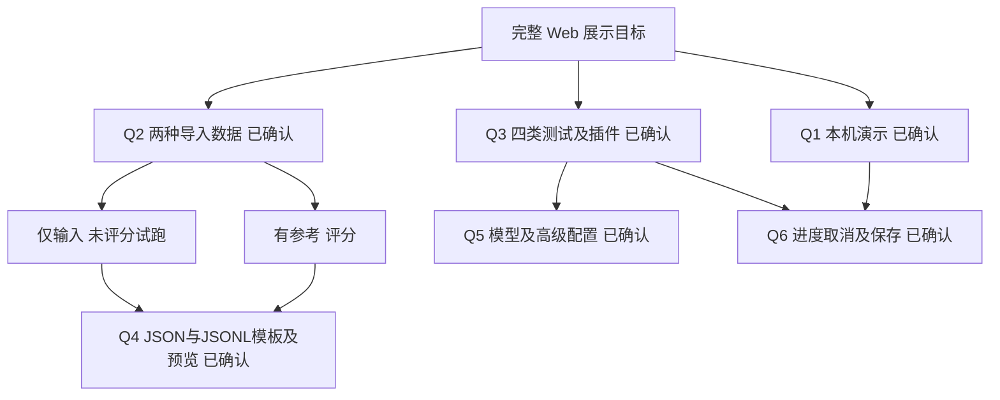

# POC Web 展示设计与实现

Web 展示需要覆盖数据、模块、运行测试、结果、导入和历史六项功能，并复用现有 POC 的执行与评分逻辑。六项设计选择均已确认：本机演示、两种导入数据、四类测试及插件、JSON/JSONL 模板与预览、模型及高级配置、真实取消与结果保存。用户已确认完整方案。Web 功能已实现，验收记录见 `reports/verification-web.json`，操作说明见 `docs/web-poc-guide.md`。

## 基础能力

基础冻结数据包括情绪分析 600 条、动态规划 80 条、完整流程 32 条、工程回归 60 条内置案例，以及实现 Web 前的 41 次历史运行，其中 12 次为 V2；Web 与 CLI 的后续记录会持续增加。插件目录注册 BALADY、SAKANI、940、FURAS 四个系统，包含 13 项 capability 和 16 个业务工具。

`runV2Evaluation` 已提供案例执行、模块评分、模型选择、并发和预算参数。结果包含模型输出、校验、调用参数、回执、mock oracle、耗时及源码和数据指纹。冻结集加载器读取 `datasets/v2.0`；导入集经校验后注入执行入口。现已通过 Web 服务、导入仓库和持久任务接口扩展，继续复用原执行器和评分器。

## 六项功能与验收条件

| 用户要求 | 建议的页面行为 | 完成时需要的证据 |
| --- | --- | --- |
| 浏览测试数据 | 列出数据集和版本；按模块、split、语言筛选；搜索案例；查看多轮输入、参考和标签 | 在浏览器打开内置和导入数据，确认案例总数、筛选及详情与实际文件一致 |
| 浏览模块 | 显示职责、版本、输入格式、可用数据集和指标；插件页显示能力、工具参数及完成条件 | 页面内容来自实际模块和注册表；选定的模块范围均可查看 |
| 针对模块和数据集运行测试 | 选择兼容数据集、全量或案例子集；设置模型及预算；显示进度和状态 | 浏览器发起真实任务，核验所选案例、模型、数据版本及实际执行记录；不兼容组合明确拒绝 |
| 查看测试结果 | 汇总指标、评分覆盖、错误和耗时；逐案查看原话、预测、参考、参数、回执及评分依据 | 完成任务的页面指标与评分器一致；错误与未评分案例不隐藏，也不显示虚假的通过率 |
| 导入新的测试数据集 | 选择文件或使用模板；先校验、预览，再保存新版本；展示具体错误位置 | 合法数据可导入并运行；重复 ID、非法标签、关联缺失及模块不兼容被拒绝；内置冻结集未被覆盖 |
| 查看历史运行结果 | 按模块、模型、数据版本和状态筛选；打开详情；再次运行创建新记录 | 当前历史记录可浏览；新运行刷新页面后仍存在；重新运行保留原结果和配置 |

浏览器验收必须覆盖实际操作、请求和落盘结果，不能仅用前端截图或后端单元测试证明六项功能完成。

## 已确认的设计树

两轮设计选择均已确认。导入采用 JSON/JSONL，加模块模板、预览和错误定位。运行提供两个模块的模型选择及折叠高级参数。任务显示真实进度，支持实际取消并保留部分结果，刷新后继续查看状态和历史。

本机范围不引入团队账号或公网部署。四类测试为 emotion、planning、integration、engineering，业务目录展示四个系统的能力和工具说明。

## 数据导入与评分边界

内置 V2 的 `inputs.jsonl`、`references.jsonl`、`manifest.jsonl` 按 `case_id` 关联。导入集采用 JSON/JSONL，模块模板明确输入、可选参考和元数据字段。导入先校验并预览，再保存独立 ID、版本和指纹；保存新版本，不改变已发布的冻结数据。

情绪输入为 `messages/current_message_id`；规划和完整流程输入为 `actor/turns`；工程测试输入为故障契约 `test_type`。页面和服务端都校验模块兼容性，不能直接将任意文本送到任意模块。

仅输入的案例可以展示预测、执行状态、工具参数、回执、错误、耗时和 tokens，无法据此计算真实准确率、Precision、Recall、F1。有参考答案才计算相应指标，同时展示实际评分覆盖数；参考答案在执行后进入评分器，不提供给模型。

规划参考仅给出工具名时，只能证明工具选择。严格任务评分还需要对象、参数、状态、调用依赖及断言等契约，不能以选对工具替代完整业务正确性。合成且未经专家审核的参考保留 provisional 标记。

## 运行与取消接口

评测入口现接收经过校验的数据集版本，解除固定路径与执行器的耦合。执行后才评分，兼容仅输入、部分参考和完整参考三种状态。

运行任务持久记录配置、所选案例、预算、进度和终态，区别于目前只在运行完成后追加的历史索引。页面刷新不导致运行重复启动，也不失去已完成结果。用户已确认提供真实取消及部分结果。

运行页面分别设置 emotion model 和 planner model，第一版使用现有 DeepSeek 供应商。高级配置包含案例子集、split、并发、请求和 token 预算、flat/layered 及工具目录规模。每次保存有效配置，便于后续更换模型并查验结果差异。

## 页面与实现方案

本地服务复用 Node 项目，通过 `npm run web` 启动，仅监听本机地址。页面采用中文导航，覆盖测试数据、模块与插件、新建测试、运行结果、历史运行和数据导入。数据、运行及报告使用项目内的持久存储，继续保留现有 CLI 能力。

测试数据页支持列表、筛选、搜索和详情；模块页显示当前协议和插件目录。新建测试页只允许匹配的模块与数据集，选择全量或子集，并在高级配置中修改模型和运行参数。

运行页持续显示完成数、错误、预算使用和当前状态。取消实际停止请求及后续案例调度，保留部分结果。结果页区分正确性评分与仅输入试跑，能查看逐案工具、参数、回执和评分原因，也能下载报告。历史页保留原版本和原始指标定义，重新运行创建新记录。

实现后验收六项功能，重点验证浏览器发起真实模型测试、导入的新数据确实进入执行器、取消确实停止执行、刷新后记录仍存在，以及全部旧历史可查询。浏览器操作验证与必要的接口、评分和调度测试共同构成完成证据。

统一取消信号已贯穿模型、Pi、后方请求和案例调度；保留已完成案例，并将其余案例标为取消或未执行，不能以更小分母生成完整回归通过结论。

API key 保持在服务端配置中。页面浏览模块和模型配置不需要返回凭证。测试结果继续基于实际回执及 mock oracle，人工接通仍按模拟状态呈现。

## 历史结果兼容

旧版 semantic 包含业务 intents，V2 emotion 已移除；旧规划使用 `operation_selection`，V2 使用 `tool_selection`。历史页面需要保留原指标定义、数据版本、样本范围和源码指纹，不能跨版本混算。

部分历史记录没有数据版本或完整输入。只有找到并核验匹配的数据集指纹后，才能关联补充输入；相同 `case_id` 本身不足以证明版本相同。烟测、完整评测及旧评分器记录应明确区分。

导入数据可以进行自己的评分和门槛检查，但不能冒用内置 V2 冻结集的回归结论。重新运行创建新记录，不覆盖旧报告。

## 实现依据

[评测入口](../src/evaluate-v2.mjs)、[情绪分析](../src/analyzer.mjs)、[动态规划](../src/entry-agent.mjs)、[模型调用](../src/model.mjs)、[Mock 适配器](../src/mock-client.mjs)、[能力注册表](../src/capability-registry.mjs)、[V2 数据说明](../datasets/v2.0/README.md)、[当前评测结果](../reports/latest-v2.md)。

Web 页面与本机运行服务已实现。通过 `npm run web` 启动；运行结果、导入版本和任务状态均在本地保存。逐项验证记录保存到 `reports/verification-web.json`。
