# SENTRA 情绪分析测试用例操作指南

本指南演示如何新增情绪分析用例、导入测试集、运行模型、核对结果并重复回归。入口是 [SENTRA 本机评测台](http://127.0.0.1:8787/#import)，属于 [Web 使用指南](web-poc-guide.md) 的子文档。

选择 **情绪分析** 模块即可独立验证情感分类。该模块读取用户原话和会话上下文，不启动动态规划、不调用业务工具，也不执行转人工。当前评分检查 `sentiment + assessment_status`；七类 `emotions` 保留在输出中供调试，不参与效果评分。

**增加用例的方式是编辑 JSON / JSONL 文件，再导入一个新数据版本。** 页面上的内置冻结集和已保存的导入集均只读，不能在列表中直接追加或修改。新导入不会自动并入内置的 620 条情绪回归集。

## 开始前准备

在项目根目录执行 `npm run web`，然后打开 `http://127.0.0.1:8787`。如果页面已能访问，无需再次启动。首次环境安装和模型凭证配置见 [Web 使用指南](web-poc-guide.md)；页面顶部出现“模型凭证已配置”后，可以运行真实情绪测试。

准备一个文本编辑器，将文件保存为 UTF-8。首次操作可直接使用下面的完整示例：

- [JSON 示例文件](examples/emotion-cases-example.json)：含数据集名称、版本、模块及 8 条案例，推荐首次使用。
- [JSONL 示例文件](examples/emotion-cases-example.jsonl)：相同的 8 条案例，每行一个案例对象；名称、版本和模块在导入页填写。

本次示例使用人工编写的教学参考，`status` 为 `provisional`。它们可以用于操作练习；用于业务验收前，应先完成独立的语言和业务审核。

| 案例 | 场景 | 参考 sentiment | 参考 assessment_status |
| --- | --- | --- | --- |
| SENTRA-EMO-001 | 中文材料咨询，没有情绪表达 | neutral | classified |
| SENTRA-EMO-002 | 中文明确满意和感谢 | positive | classified |
| SENTRA-EMO-003 | 中文明确失望，问题仍未解决 | negative | classified |
| SENTRA-EMO-004 | 阿语材料咨询，没有情绪表达 | neutral | classified |
| SENTRA-EMO-005 | 英文先感谢，随后明确表达当前失望 | negative | classified |
| SENTRA-EMO-006 | 英文问题解决后明确满意 | positive | classified |
| SENTRA-EMO-007 | 多轮对话，从历史失望转为当前满意 | positive | classified |
| SENTRA-EMO-008 | 输入仅为 `...`，表达不完整 | null | needs_clarification |

## 步骤 1 打开导入页并选择情绪分析

1. 点击左侧 **导入数据集**。
2. 将 **模板 / JSONL 适用模块** 设为 **情绪分析**。
3. 将 **文件格式** 设为 **JSON**。

预期：右侧模板下载链接对应情绪模块；左侧显示文件选择、数据内容、校验和保存控件。JSON 模式下，名称、版本和模块从文件对象读取，页面的“JSONL 数据集名称 / JSONL 版本”不决定 JSON 文件的名称和版本。

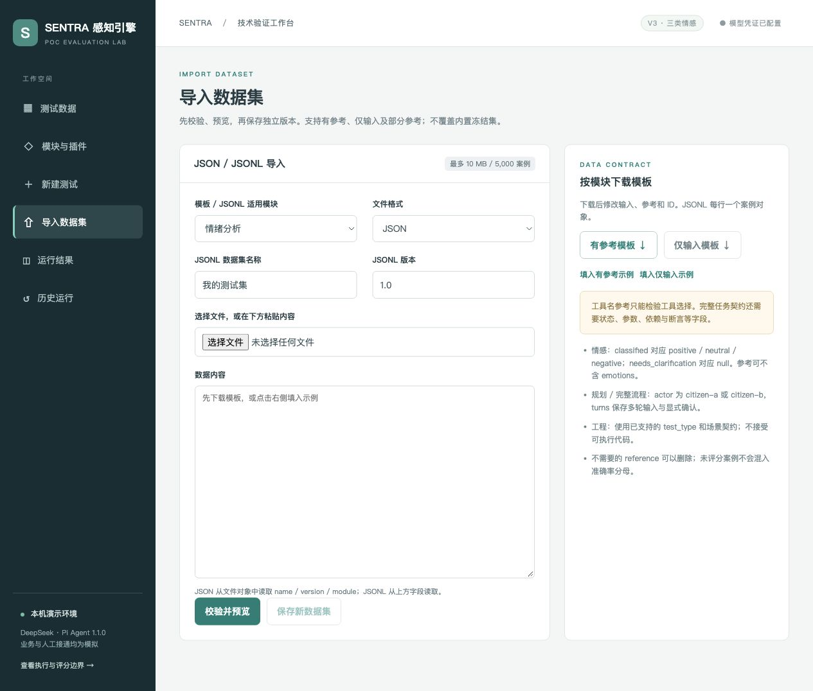

## 步骤 2 获取有参考模板

1. 点击右侧 **有参考模板 ↓**，下载 `emotion-with-reference.json`。
2. 用文本编辑器打开文件，按步骤 3 修改输入、ID 和参考答案。
3. 若希望直接在页面编辑，可点击 **填入有参考示例**。示例会填入左侧“数据内容”，此时还没有保存数据集。

需要自动计算正确率时，使用“有参考模板”。“仅输入模板”用于观察预测，未提供 `reference` 的案例不计算 Accuracy、Precision、Recall 或 F1。模板中的参考属于原输入；修改原话后，必须重新检查参考标签及可选证据，不能沿用不匹配的旧参考。

截图显示点击“填入有参考示例”后的真实页面。也可跳过模板编辑，直接选择本指南附带的 8 条 [JSON 示例](examples/emotion-cases-example.json)。

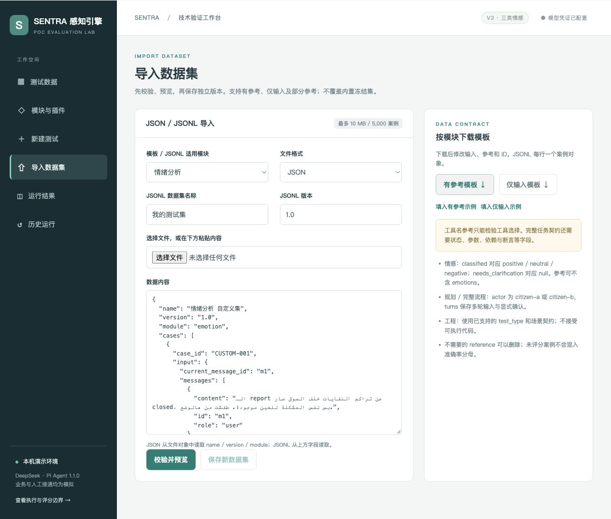

## 步骤 3 编写或增加用例并载入文件

JSON 数据集必须包含 `name`、`version`、`module` 和 `cases`。下面是可单独导入的最小示例：

```json
{
  "name": "我的情绪回归集",
  "version": "1.0",
  "module": "emotion",
  "cases": [
    {
      "case_id": "CUSTOM-EMO-001",
      "input": {
        "messages": [
          {"id": "m1", "role": "user", "content": "处理结果很满意，谢谢你们。"}
        ],
        "current_message_id": "m1"
      },
      "reference": {
        "sentiment": "positive",
        "assessment_status": "classified",
        "status": "provisional"
      },
      "metadata": {"split": "regression", "language": "zh"}
    }
  ]
}
```

| 字段 | 如何填写 | 常见错误 |
| --- | --- | --- |
| name | 自定义集名称，例如“我的情绪回归集” | 空名称，或在 JSON 模式下仅改页面的 JSONL 名称 |
| version | 字符串，例如 `"1.0"`、`"1.1"` | 写成数字 `1.0` |
| module | 固定为 `"emotion"` | 误用规划或完整流程模块 |
| case_id | 数据集内唯一，例如 `CUSTOM-EMO-001` | 重复 ID、空格或中文；允许字母、数字、下划线、连字符，最多 120 字符 |
| input.messages | 按会话顺序保存消息；每条有 id、role、content | 消息 ID 重复、原话为空、缺少 role |
| input.current_message_id | 指向本次要判断的一条已有 user 消息 | 指向 assistant、指向不存在的消息、仍指向历史用户消息 |
| reference | 保存独立确认的期望结果；未知时可删除或设为 null | 把本次模型输出直接当作已确认参考 |
| metadata.split | `dev`、`regression` 或 `holdout`；日常补充建议 regression | 写成 `all`；all 是运行筛选值，不是案例 split |
| metadata.language | 例如 `zh`、`en`、`ar`；无法识别可用 `unknown` | 语言标签与实际输入不一致，影响分组检查 |

参考字段的配对规则如下。`null` 必须写为 JSON 空值，不能写成字符串 `"null"`。

| 表达 | sentiment | assessment_status |
| --- | --- | --- |
| 明确当前满意、感谢或认可 | positive | classified |
| 可理解的事实、咨询、编号等，没有情绪表达 | neutral | classified |
| 明确当前不满、愤怒、失望、挫败或担忧 | negative | classified |
| 表达不完整、无法理解，或相互竞争的态度确实没有主导方向 | null | needs_clarification |

“缺少申请编号”不等于情绪无法判定。例如“请帮我查申请进度”是可理解的中性请求，应标 `neutral + classified`。明确的当前不满优先于开头的礼貌感谢；历史失望后明确表示现在满意，判断当前满意。

参考可以省略 `emotions` 和 `evidence`。若提供 `emotions`，只能使用 `satisfaction`、`gratitude`、`frustration`、`anger`、`worry`、`disappointment`、`confusion`；它们不参与核心评分。若提供 `evidence`，`quote` 必须是所引用用户消息中的逐字原文，`label` 必须对应已分配的情感或情绪标签。

**追加到自己已有的测试集：** 打开自己保存的原始 JSON，在 `cases` 数组末尾添加案例对象，给新案例分配唯一 ID，将版本改为 `"1.1"`，保存整个文件，再按步骤 4、5 导入。若只导入一条新案例，得到的是一个单条测试集，不会自动合并到旧集。内置集是冻结基线，新增用例先作为独立扩展集管理。

文件编辑完成后，点击 **选择文件，或在下方粘贴内容**，选择 JSON 文件；也可以把整个 JSON 对象粘贴进“数据内容”。两种方式均需继续校验。

预期：数据内容显示文件文本。截图使用本指南的 8 条示例文件。

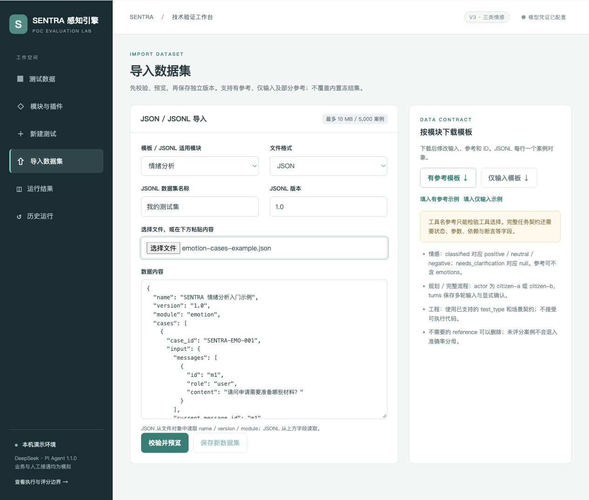

## 步骤 4 校验并修正错误

1. 点击 **校验并预览**。
2. 若校验失败，阅读红色错误卡中的字段路径，回到“数据内容”或编辑器修正对应字段。
3. 重新点击 **校验并预览**。每次改变内容、格式或 JSONL 名称等配置后，必须重新预览，才能保存。

例如，将第一条案例的 `sentiment` 误写为旧值 `mixed`，会定位到 `/cases/0/reference/sentiment`。数组下标从 0 开始，所以 `cases/0` 是第 1 条案例；同一错误可能产生多个 Schema 校验提示。当前只允许三类情感，无法判定由 `null + needs_clarification` 表达。

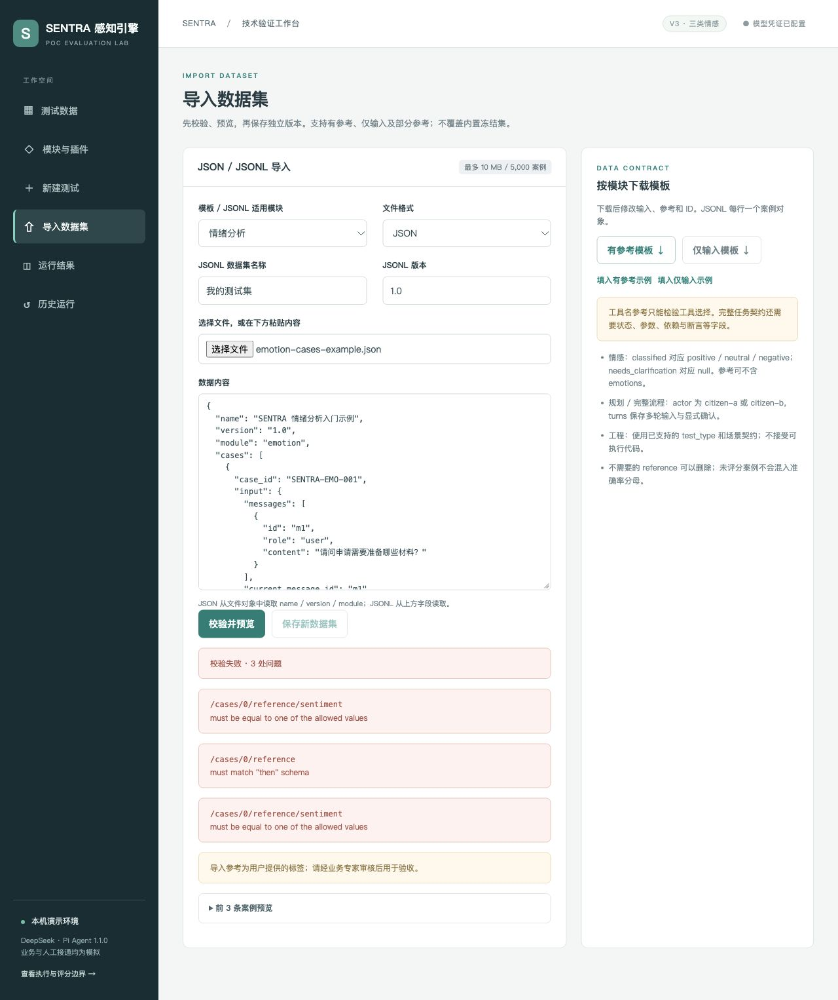

修正后检查绿卡中的数据集名称、案例数和有参考数量。本示例应显示 **8 条案例，8 条有参考**，并启用 **保存新数据集**。校验通过证明文件结构合法；参考标签的语义正确性仍需人工复核。

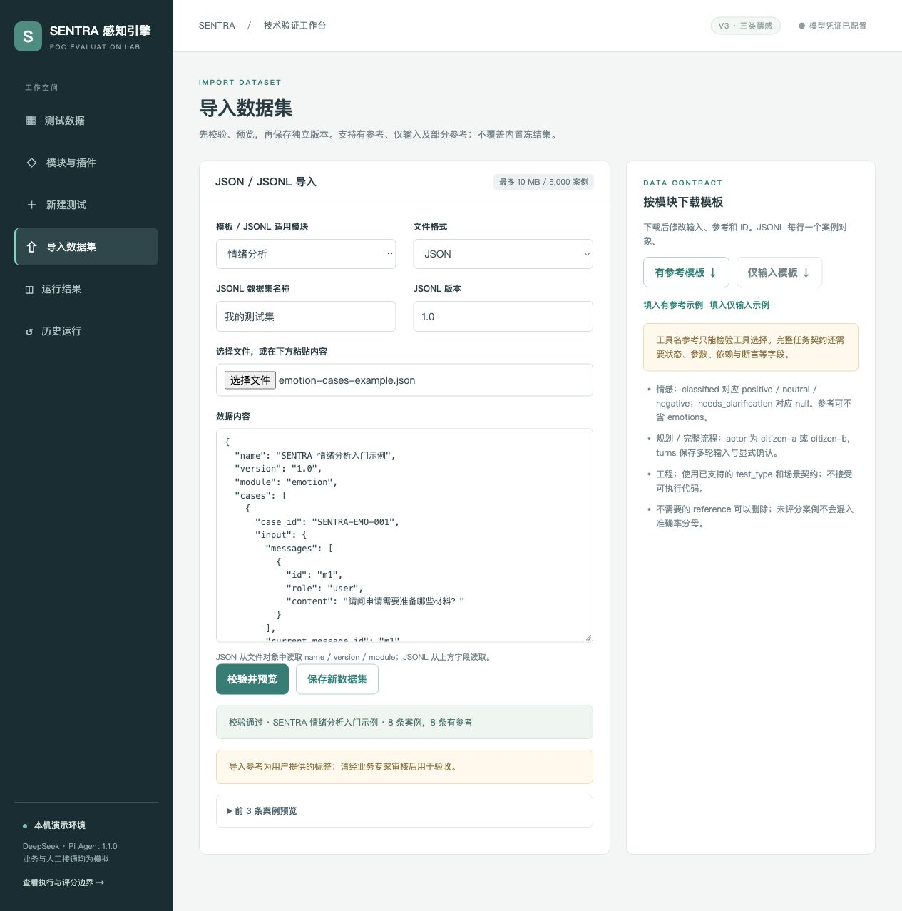

文件必须不超过 10 MB，案例数量为 1–5,000。不要在测试文件中放入模型凭证；页面会拒绝检测到 API key 的内容。

## 步骤 5 保存并核对数据版本

1. 点击 **保存新数据集**。
2. 保存成功后，页面自动进入该版本的案例列表。
3. 检查页面标题、版本、总数、有参考数量，以及表格中的原话和语言。必要时点击案例右侧 **详情**，核对输入及参考。

预期：本示例显示 **SENTRA 情绪分析入门示例**、版本 **1.0**、总计 **8 条**、有参考 **8 条**。底部保留该版本的数据 SHA256；以后回归可以核对是否使用了同一数据版本。

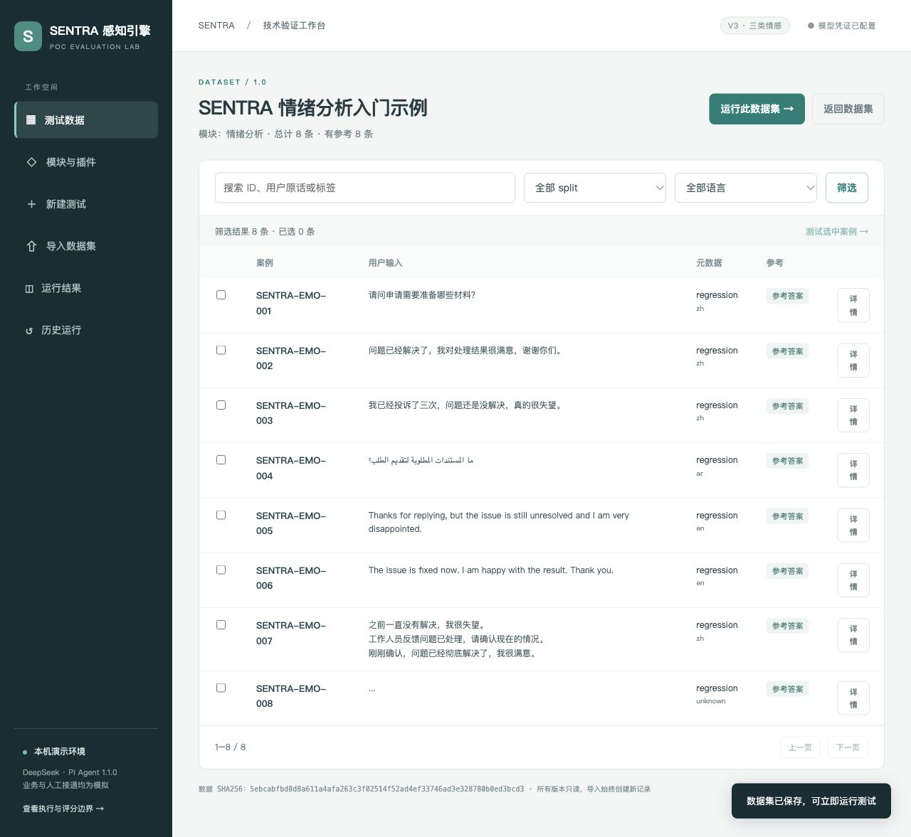

多轮案例依然是一条独立分类用例。`messages` 保存完整上下文，`current_message_id` 指向本次要判断的消息。SENTRA-EMO-007 的历史用户消息为失望，当前用户消息为满意，参考应对应当前消息。若要测试同一对话的两个判断时点，建立两条案例，分别保存截至各判断时点的上下文和当前消息 ID。

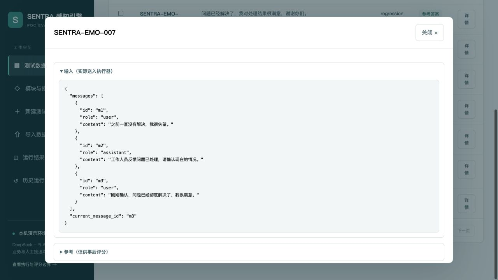

即使名称和版本相同，再次导入也会创建新 ID，不覆盖旧记录。日常维护仍建议递增版本，方便识别。

## 步骤 6 配置独立情绪测试

1. 在刚保存的数据集页面点击 **运行此数据集 →**。
2. 检查 **测试模块 = 情绪分析**，并检查 **数据集版本** 是刚导入的版本。
3. 在 **情绪模型 · DeepSeek** 选择模型。首次可选 `deepseek-flash`；更换模型时使用同一数据版本，便于比较。

预期：页面提示 **8 条案例 · 8 条有参考 · 0 条仅输入**；“规划模型”处于禁用状态，独立情绪测试不会调用它。


展开 **高级配置 · 案例子集、并发、预算、工具目录**。本次演示使用以下参数：

| 参数 | 演示值 | 用途 |
| --- | --- | --- |
| 数据 split | 全部案例 | 包含该数据集所有 split；页面值为 all |
| 最多案例数 | 留空 | 执行筛选后的全部案例 |
| 案例并发 | 1 | 顺序执行，首次观察方便；可配置 1–8 |
| 最多模型请求 | 24 | 8 条案例的请求上限；每条正常一次，结构修复可能再调用一次 |
| Token 总预算 | 100000 | 预留量及实际用量共同约束；这是上限，不是固定消耗 |
| 指定案例 ID | 留空 | 留空执行全部；小范围复查可填写 ID，以逗号或换行分隔 |

工具选择策略和工具目录规模在情绪独立测试中不起作用，可保留默认值。ID、split 和最多案例数会同时筛选；如果只想测某条用例，必须确保它也符合所选 split。

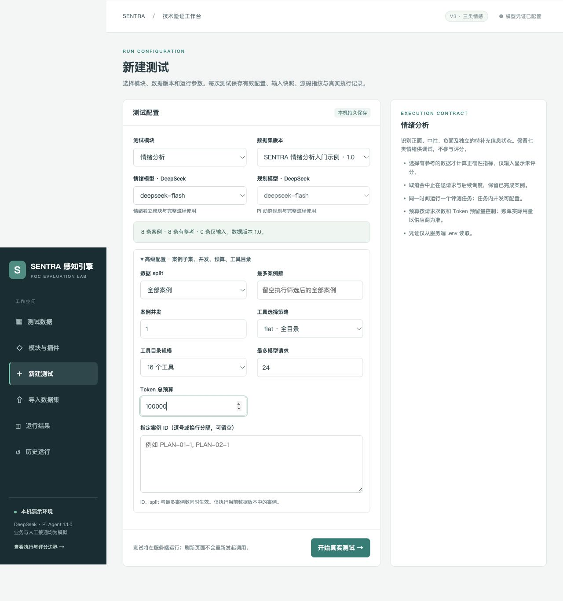

## 步骤 7 开始测试并观察进度

1. 点击 **开始真实测试 →**。
2. 页面自动跳转到新的运行记录，显示状态、已结算数量、执行中的案例、请求次数及 Token 用量。
3. 等待状态变为 **已完成**。若需要停止，点击 **取消并保留部分结果**；取消后的结果只能作为部分运行查看。

预期：这是一次真实的情绪模型调用。刷新页面不会重复启动任务；运行中的进度自动更新，展开的配置面板和滚动位置会保留。一次只能运行一个评测任务，已有任务运行时需等待完成或取消。

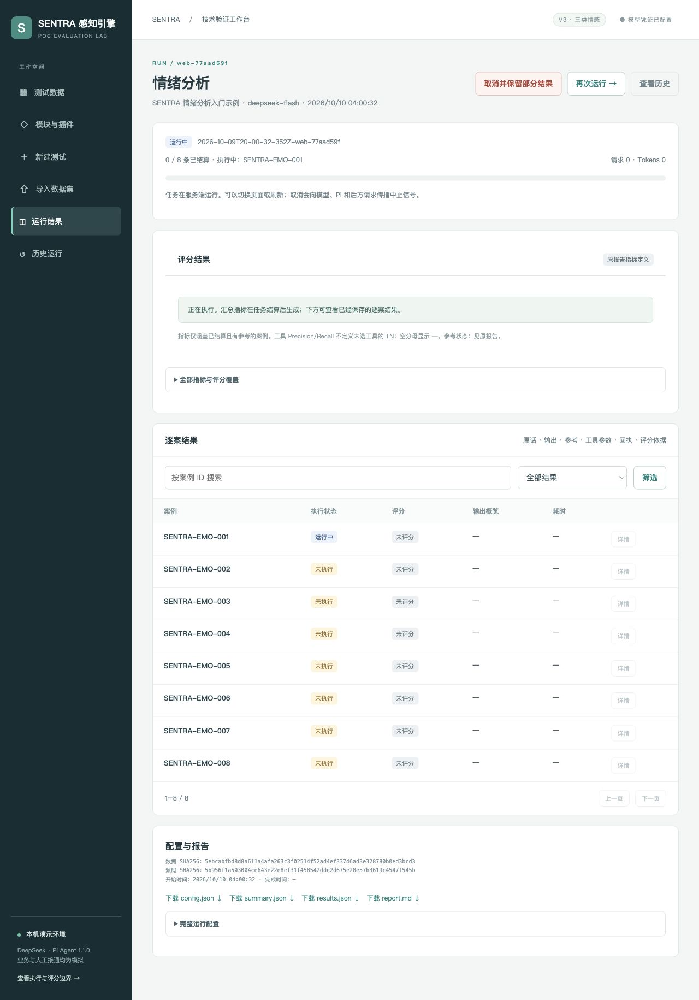

## 步骤 8 查看汇总和逐案结果

运行完成后，先确认结算范围。本示例为 **选中 8、完成 8、有参考评分 8、错误 0**。

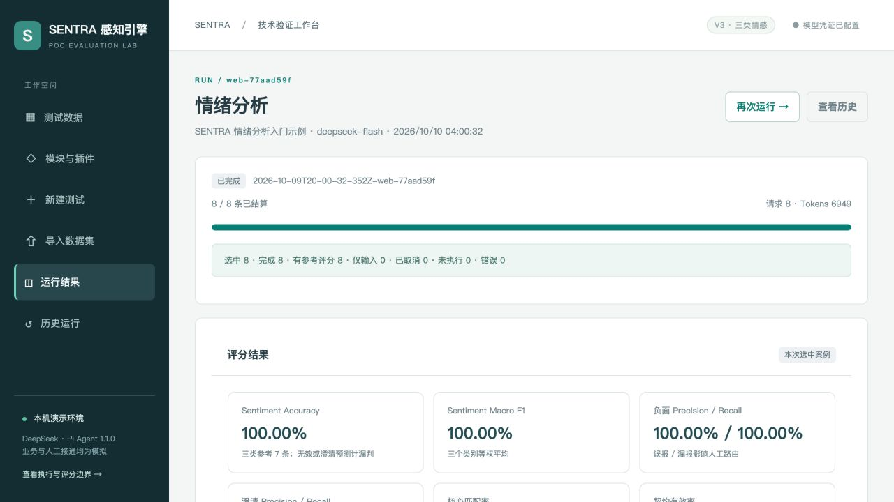

| 指标 | 如何阅读 |
| --- | --- |
| Sentiment Accuracy | 分母是参考为 classified 的案例。本示例为 7 条；1 条澄清参考不进入此分母 |
| Sentiment Macro F1 | positive、neutral、negative 三类 F1 等权平均；对澄清案例误判为三类，也会产生对应类别的 FP |
| 负面 Precision / Recall | Precision 看负面误报，Recall 看负面漏报；展开标签表可看到 TP / FP / FN |
| 澄清 Precision / Recall | 检查 needs_clarification 的误报和漏报；在全部有参考案例上统计 |
| 核心匹配率 | 同时检查 sentiment 与 assessment_status；本示例分母为 8 条 |
| 契约有效率 | 检查模型输出结构、合法标签、状态配对及原话证据；不等于语义全部正确 |

展开 **Sentiment 各标签 · 含 negative 转人工误报 / 漏报** 和 **判定状态 · 待补充信息**，核对逐类指标及支持数。表头涉及“转人工”是结果页的通用说明；本次情绪独立测试只分类，不会执行交接。

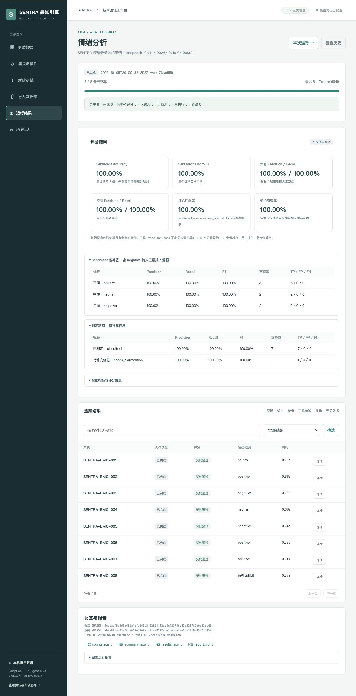

在“逐案结果”中点击 **详情**。推荐按以下顺序复核：原始输入快照中的当前用户消息 → 预测的 sentiment 和 assessment_status → evidence 是否逐字来自当前原话 → 参考与通过状态。

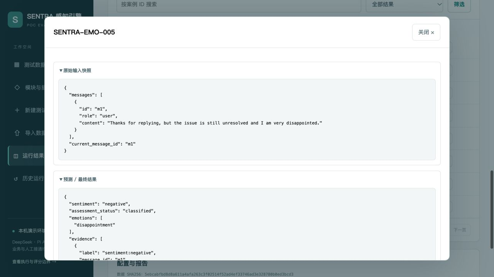

再展开 **参考答案与工具 / 任务评分**。这是共用详情区的名称；情绪用例重点查看 `reference` 和 `pass`，不评价业务工具。`emotions` 可以查看，但不要求和参考完全相同。

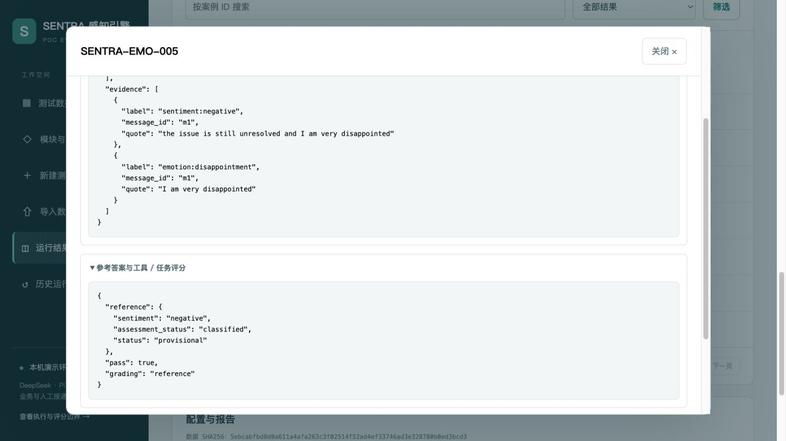

需要排查错误时，关闭详情，在“结果筛选”选择 **评分未通过** 或 **案例错误**，点击 **筛选**；“未评分”表示未提供参考，不能当作分类失败。没有某类预测或参考时，空分母指标显示 `—`，不能视为 100%。

本次教学示例 8 条核心结果全部匹配，实际使用 8 次模型请求、6,949 Tokens。小样例中的 100% 只说明本次运行匹配这些参考；模型效果应在覆盖充分、经过审核的回归集上评估。

## 步骤 9 保存报告和完整运行配置

1. 滚动到 **配置与报告**。
2. 点击 **完整运行配置** 左侧箭头，查看实际模型、案例 ID、数据指纹、源码指纹、预算及模块隔离信息。配置框中的长 JSON 可以独立滚动。
3. 点击需要的下载链接，把配置、指标及逐案结果留存到同一个评测文件夹。

| 文件 | 内容与用途 |
| --- | --- |
| config.json | 实际模型、数据版本及 hash、运行参数、所选案例；核对比较条件 |
| summary.json | 汇总指标、覆盖数量、运行状态及实际调用用量 |
| results.json | 全部逐案输入、预测、参考、通过状态及模型调用记录；用于分析失败案例 |
| report.md | 本次评测的 Markdown 报告 |

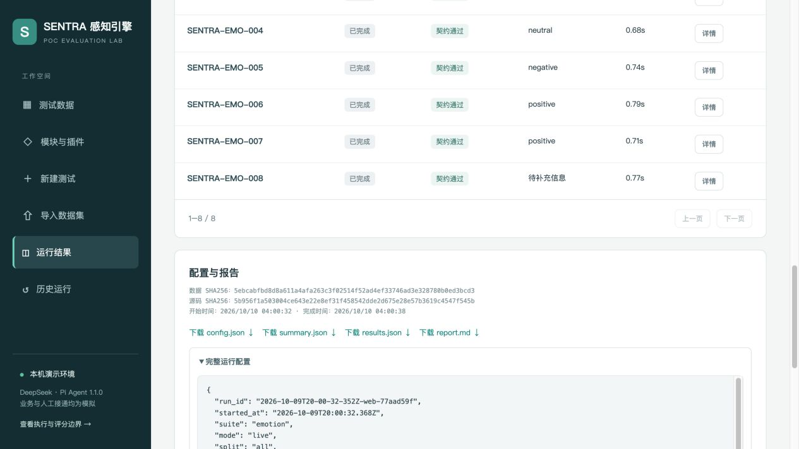

本次完整示范的实际结果页：[查看 8 条情绪用例运行记录](http://127.0.0.1:8787/#run/2026-10-09T20-00-32-352Z-web-77aad59f)。文件保存在项目的 `reports/history/2026-10-09T20-00-32-352Z-web-77aad59f/`。运行配置中的 `module_isolation` 为 `no planner/tools`；`source_consistent` 为 true。

## 步骤 10 使用同一数据版本重复回归

1. 点击左侧 **历史运行**。
2. 将“历史模块”筛选为 **情绪分析**，输入数据集名称，点击 **筛选**。
3. 找到原运行，点击 **查看结果**。

预期：可检索到同一数据集的历史模型和指标。导入集仍保留原始版本，历史记录不会被新运行覆盖。

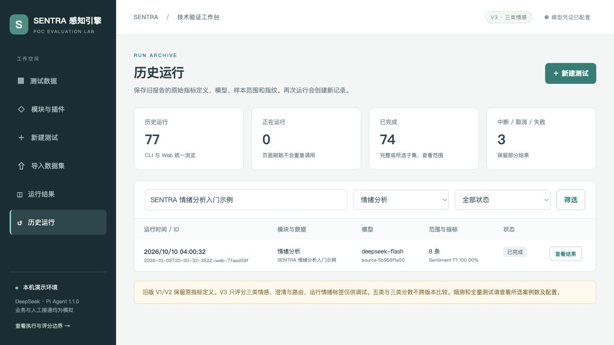

在结果页点击 **再次运行 →**，检查恢复后的数据集、案例范围和预算，再点击 **开始真实测试 →** 创建新记录。更换模型时，只改“情绪模型”，保持案例范围一致；修改提示词后，也重复运行同一数据版本。比较两次 config 的数据 hash、selected_case_ids 及 summary 的覆盖数量，确认样本范围一致。

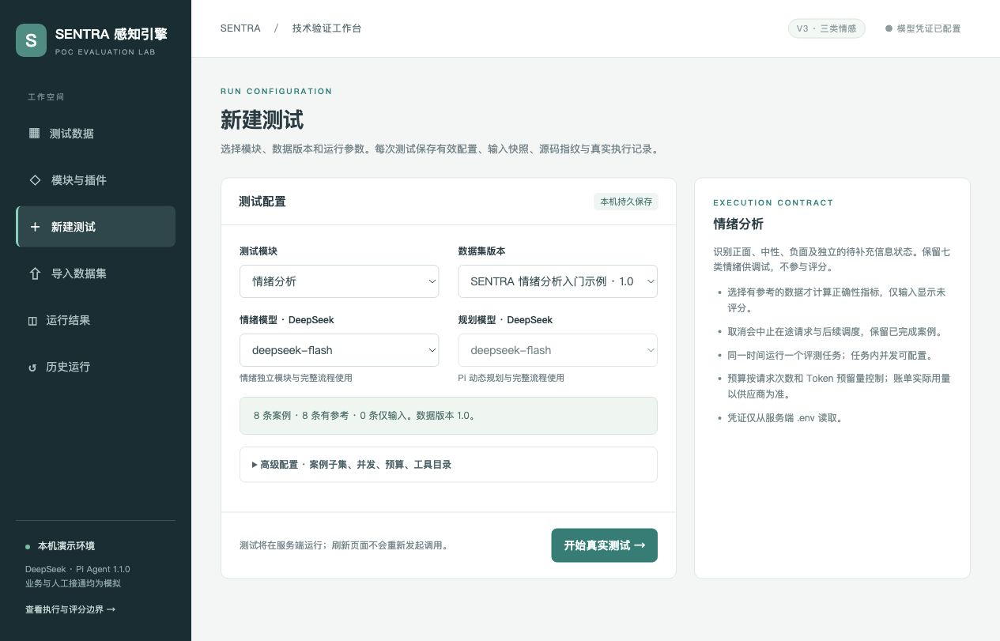

需要追加或修正参考时，回到原始文件增加案例或修改标签，递增版本后重新导入。数据内容变化后，不能将新旧总分差异全部归因于模型变化；比较模型应使用相同版本的参考和输入。本次“再次运行”截图停留在配置页，未重复发起模型请求。

## 可选步骤 11 改用 JSONL 导入

JSONL 适合批量生成和逐行维护。每个非空行都是一个完整的案例对象，包含 `case_id / input / reference / metadata`，不含外层 `name / version / module / cases`。一条案例必须放在一个物理行；字符串中的换行需要使用 JSON 转义。空行允许。

例如，单条 JSONL 的一行可以写为：

```jsonl
{"case_id":"CUSTOM-EMO-001","input":{"messages":[{"id":"m1","role":"user","content":"处理结果很满意，谢谢你们。"}],"current_message_id":"m1"},"reference":{"sentiment":"positive","assessment_status":"classified","status":"provisional"},"metadata":{"split":"regression","language":"zh"}}
```

1. 打开 **导入数据集**。
2. 模块选 **情绪分析**，格式选 **JSONL**。
3. 填写 **JSONL 数据集名称** 和 **JSONL 版本**。这两个字段在 JSONL 模式下会成为保存的数据集名称及版本。

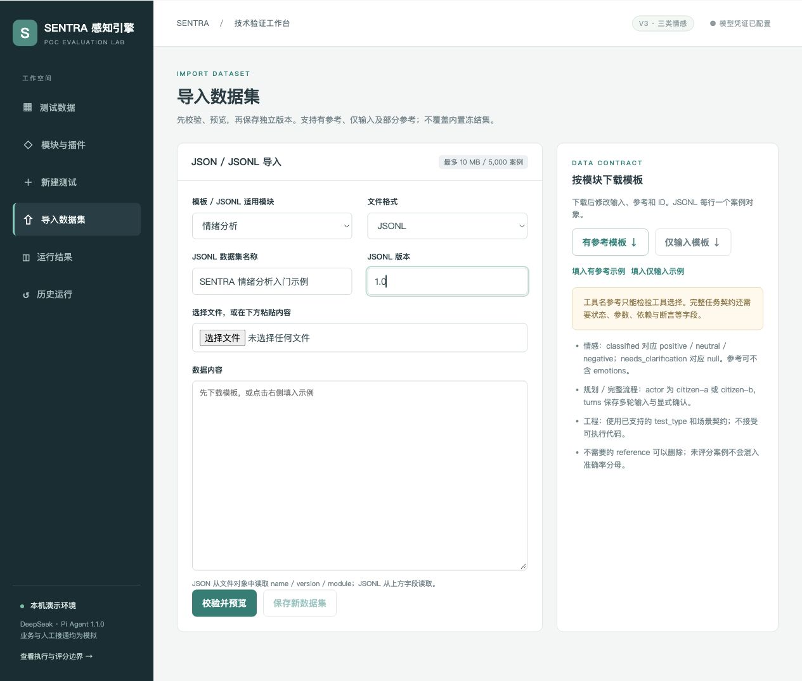

## 可选步骤 12 载入 JSONL 并预览

1. 选择本指南的 [JSONL 示例文件](examples/emotion-cases-example.jsonl)，或粘贴完整内容。
2. 点击 **校验并预览**。校验错误会包含原文件行号；行号从 1 开始，字段路径仍从 `cases/0` 开始。
3. 确认案例数和有参考数量后，点击 **保存新数据集**，继续主流程步骤 5–10。

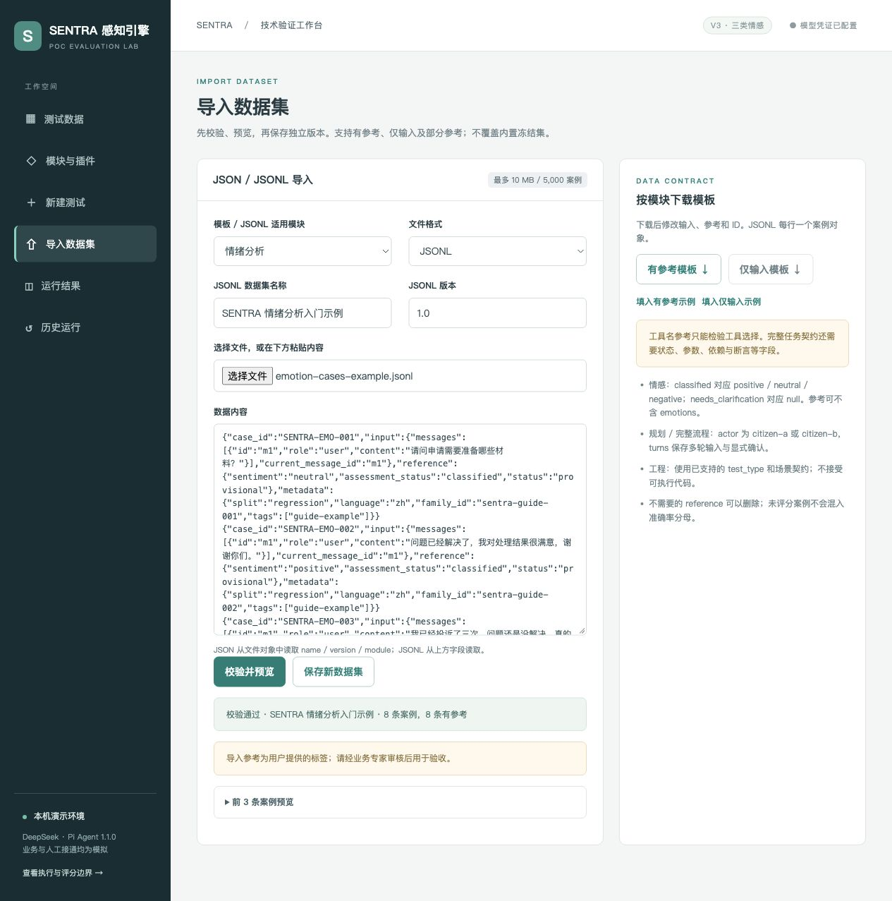

本截图只验证 JSONL 预览，没有再次保存重复数据集；它与 JSON 示例包含相同的 8 条案例。

## 新增案例时如何保证覆盖

日常增加用例时，先补充实际发现的误判，再添加只改变关键表达的相邻样例。例如，将“问题没解决，请查进度”与“问题没解决，我很失望”成对加入，检查模型是否把事实误当情绪。

| 覆盖方向 | 建议增加的对照 |
| --- | --- |
| 基础类别 | 正面、中性、负面，以及需要澄清的输入；各类有足够支持数 |
| 事实与态度 | 问题未解决的事实 / 明确表达不满；缺业务编号 / 表达无法理解 |
| 礼貌与主导情绪 | 单纯感谢 / 感谢后仍明确失望；真正满意 / 讽刺性表扬 |
| 否定与引用 | “我不生气” / “我很生气”；他人的情绪引语 / 用户自己的当前态度 |
| 历史与当前 | 历史负面转当前正面 / 历史正面转当前负面；原话指向不同消息时分别建例 |
| 多语言 | 中文、英文、阿语、沙特方言及混合语言；由相应语言人员复核自然度与参考 |
| 输入质量 | 完整请求、短编号回复、截断、无法理解或转写丢失；不把普通中性短句都标为澄清 |

保留原话与独立参考，记录 `family_id`、语言及 split。相近改写使用同一 family_id；划分 dev / regression / holdout 时，人工确保同一家族不跨组，当前导入校验不会自动执行家族隔离。未知标签先保留为仅输入案例，审核后再增加参考；不要为凑齐评分范围强行猜标签。

## 常见问题与处理

| 问题 | 处理方式 |
| --- | --- |
| 保存按钮不可点击 | 先预览并修正所有错误；改过文本后重新预览 |
| 数据集名称不符合预期 | JSON 改文件内 name / version；JSONL 改页面上的名称 / 版本 |
| 重复 ID | 数据集内每条 case_id 必须唯一；同一案例中的消息 id 也不能重复 |
| current_message_id 报错 | 指向 messages 中真实存在的 user 消息 |
| 参考标签结构报错 | classified 配三类之一；needs_clarification 配 null；删除旧 mixed、undetermined 等标签及旧指标字段 |
| 没有 Accuracy / F1 | 检查 reference 是否缺失或为 null、是否尚未结算；只有输入就显示未评分 |
| 分母和总案例数不同 | 检查参考数量、classified 参考数量及部分运行覆盖，不能只看总数 |
| 只执行部分用例 | 检查 split、指定案例 ID、最多案例数及是否使用“测试选中案例” |
| 超过预算或被取消 | 查看执行状态和逐案错误；调整参数后显式创建新运行，旧结果保留 |
| 加了用例但内置仍显示 620 条 | 导入会创建独立扩展集；运行时选择新版本，内置冻结集不会自动追加 |

返回 [SENTRA Web 使用指南](web-poc-guide.md) · [项目说明](../README.md)。
