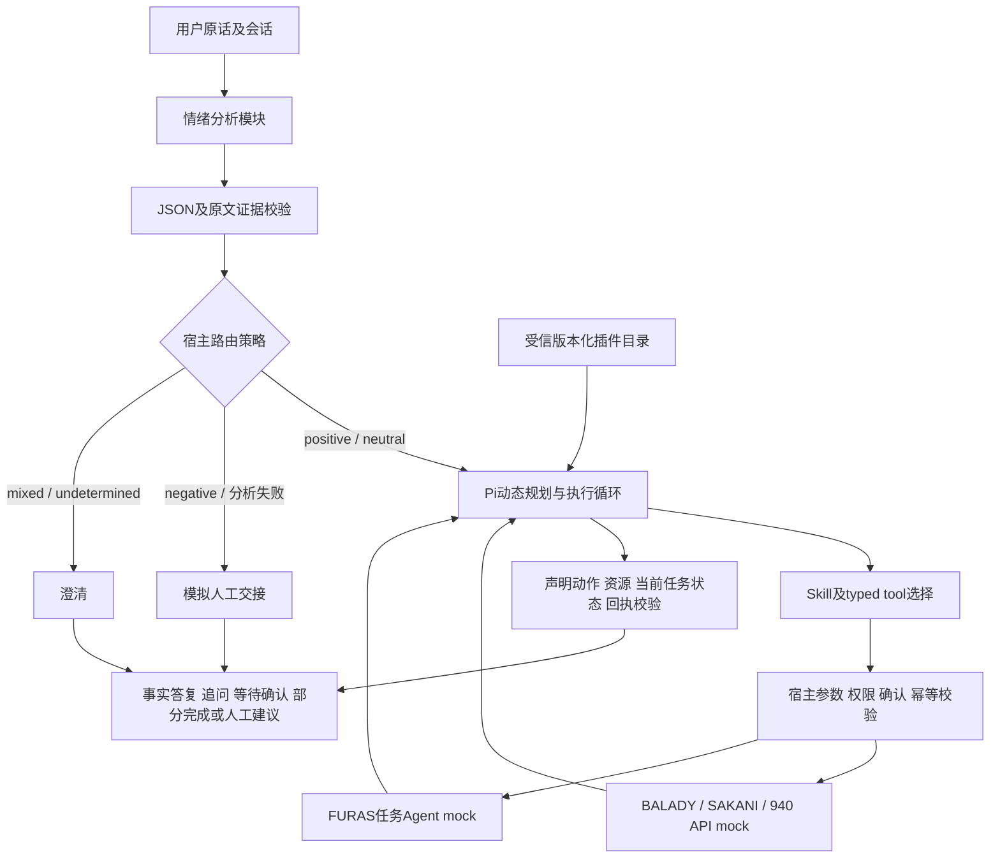

> 历史 V2.0 方案，保留用于复查；当前运行与评测使用 [V3 方案](government-entry-agent-poc-v3.md)。以下五类情感、场景标签与恢复规则不再适用于当前版本。

# 政府业务入口 POC V2：已实现方案

2026-10-09。Pi SDK 1.1.0 + DeepSeek，四个模拟系统、16 个业务操作。情绪分析、动态规划分别调用和评测；完整入口增加宿主路由。V2 不接知识库、不 fork Pi 上游。

## 模块接口和替换

| 部分 | 接口 | 扩展方式 |
|---|---|---|
| 情绪识别 | `analyzeEmotion(client, {messages, current_message_id})` | 注入 client/analyzer，保持输出契约，独立重跑 emotion suite |
| 情绪契约 | 5 单选 Sentiment、7 多选 Emotions、SA01–05、evidence | 标签语义变化需新契约及冻结标签版本；新增系统不增加情绪标签 |
| 宿主路由 | `decideRoute(analysis, state, input, policy)` | 配置 agent/human/clarify 映射，独立版本化 |
| 动态规划 | `EntryAgent.turn({message, confirm}, {contextMessages})` | 替换 Pi provider/model，或同一接口后更换 Harness；保留插件和评分契约 |
| 能力目录 | `loadRegistry(root)` / `makeRegistry(plugins)` | 新 manifest、Skill 和适配器，无需中央业务目的枚举 |
| 人工渠道 | connector request/release + bundle | 当前 mock，未来接真实渠道和可靠接管/释放 |

情绪模块不输出业务 intent。规划读取原话和会话，生成自然语言目标、注册能力 ID、对象、步骤与结果；能力 ID 是接入方的执行契约，不要求用户知道系统有多少 intents。`contracts.mjs` 的旧 INTENTS 仅为历史/工程兼容，V2 live 情绪 schema、planner goal schema 和完成校验不使用它。

模块独立不表示业务可提前执行：完整入口先等情绪结果再创建业务 planner。负面路径不创建 planner；每次业务调用还检查宿主许可，模型不能覆盖路由。

## 会话与执行

缺参数则追问，新消息携用户原话历史进入同一 Pi 会话。写操作先显示精确 proposal，宿主 `/confirm` 只批准该操作和参数；模型不能提供 actor、confirmation_ref、idempotency_key。Pi 根据工具结果、追问和用户修正调整下一步，不要求一次产生不可变的完整计划。

FURAS start/get/resume/cancel 模拟独立 Agent 协议，区分 pending、needs_input、failed、completed、cancelled，本轮最多轮询 3 次。完成需目标操作的成功终态回执，且当前任务状态满足能力契约；早期 pending 可保留作历史，旧 completed 不能覆盖后来 cancelled。

转人工清除尚未确认的 proposal 和授权，不回滚成功操作。交接包含原话、情绪证据、路由原因和任务快照；后续消息复用 ticket，普通中性消息不会抢回会话。明确 `/resume` 且情绪允许自助后才恢复。每轮保存独立快照，后来释放 ticket 不改写历史。

queued/connected/unavailable 均为人工模拟；分析异常不伪装 neutral，转接失败不回退自动办理。CLI 顺序处理消息，真实数字人仍需渠道授权、持久化、并发中断/接管和回复呈现，当前未承诺生产并发能力。

## 新系统接入

manifest 声明 system、plugin_version、skill_file、operations、capabilities。operation 含严格 input_schema、effect、adapter、对象字段、发现关键词；capability 含操作及 completion 的 required_operations、required_task_status 等条件。发现、工具生成和完成校验从目录读取。加载时检查重复 ID、schema、越界 Skill 路径及不一致契约。

新真实后方需要认证、权限、返回字段标准化、失败语义适配。插件不是任意用户上传代码或任意网络访问；当前支持 `http_mock`、受信 `fixture_mock`，生产适配仍需工程实现。第五个 FEES 插件已通过 SDK 脚本测试完成发票状态查询，尚无第五系统 live 模型规模评测。

flat 暴露目录，layered 先 `catalog_search` 再激活工具并续接 Pi 会话。发现关键词是目录元数据，不是知识库。主评测为 flat、16 工具；256 参数可做扩容实验，但本次指标不能推及大规模真实目录。

## 测试和报告

V2 冻结数据：emotion 600、planning 80、integration 32、engineering 60。emotion 不加载 Pi/业务工具；planning 不调用情绪或路由。integration 使用真实模型和本地 mock，检查多轮路由、非自助路径无业务执行、人工不可用和明确恢复；engineering 验证确认、权限、幂等、重试、任务生命周期。

工具 P/R 按每案不同业务工具计数，含 proposal 和拦截尝试；参考区分必需及额外允许工具。严格任务评分另查参数、对象、顺序、分轮状态、回执与 mock oracle，不能以工具名 P/R 代替完整业务成功率。

每次保存输出、修复尝试、trace、oracle、配置、数据/源码 hash；保留旧报告。命令见 [README](../README.md)，结果见 [最新报告](../reports/latest-v2.md)。参考合成且 provisional，旧 holdout 已查看，仍需沙特母语和业务专家审核。negative 直接决定人工路由，须关注其 Precision/Recall：误报会不必要转人工，漏报会错放自动执行。未达阈值的结果如实保留。
