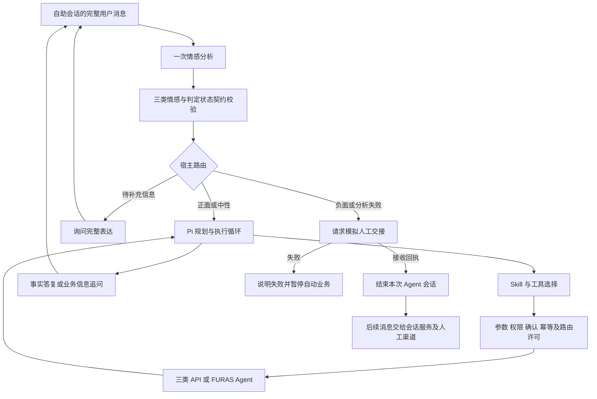

# SENTRA 感知引擎 V3 架构与评测

V3 采用 Pi SDK 1.1.0 + DeepSeek。BALADY、SAKANI、940 是模拟 API；FURAS 是模拟任务 Agent，共 16 个业务工具。当前不加入知识库。新增业务系统通过插件目录、适配器及执行契约接入，规划读取用户原话和会话，不维护中央业务目的枚举。



## 当前契约

`analyzeEmotion(client, {messages, current_message_id}, {signal})` 输出：

```json
{
  "sentiment": "neutral",
  "assessment_status": "classified",
  "emotions": [],
  "evidence": []
}
```

`classified` 必须搭配 `positive / neutral / negative`；`needs_clarification` 必须搭配 `sentiment: null`。无法判定、契约校验失败及供应商失败均不能伪装为中性。运行输出保留七类诊断情绪：satisfaction、gratitude、frustration、anger、worry、disappointment、confusion；基本结构、标签及原话证据仍需校验，它们不决定路由或效果评分。

当前态度优先。感谢夹带当前不满判负面；历史负面但现在满意判正面；事实描述和业务编号缺失可判中性；明显担忧和讽刺判负面；不完整表达或确实无法确定当前主导态度请求澄清。业务信息不足由规划器追问，不等于情感无法判定。

每条自助阶段用户消息先分析一次，包括补充编号和确认消息。Pi 内部步骤与工具结果不再次触发情感分析。正面和中性进入同一 Pi 会话，保留任务、原话及追问上下文；缺编号后的补充消息可以继续业务任务。

## 人工交接边界

宿主决定路由，业务工具调用前再次检查许可。负面路径和澄清路径的业务工具尝试及后台分发数必须为零。转人工清除未确认提案与授权，不回滚已执行业务。

模拟 connector 的 `accepted: true` 是接收交接的协议回执；queued 和 connected 都表示模拟人工系统已接收。收到回执后 `session_ended: true`，之后 `handle` 只返回 `session_closed`，不会再调用分析器、规划器或创建新交接票。后续消息的分发属于外部会话服务；旧版 `/resume` 不能恢复这个已结束会话。CLI 将后续输入显示为交给会话服务。真实客服平台不在本次范围。

unavailable 或 connector 异常意味着交接失败，说明失败并保持自动业务暂停。后续消息仍需分析，但宿主保持人工路径，可以重试交接；成功接收后结束会话。绝不因转接失败回退自动业务。`handoff_transferred` 保持 false，表明这不是现实人工接通。

## 扩展与独立测试

情感模块通过注入 client/analyzer 更换模型；路由策略单独版本化；规划器通过 `EntryAgent.turn` 接口隔离 Pi Harness；插件通过 manifest、SKILL、严格工具 schema、能力完成契约接入。各层可替换，但更改语义必须发布契约与参考数据版本并重新回归。

FURAS 区分 pending、needs_input、completed、failed、cancelled；完成必须有当前有效终态回执。写操作通过宿主 `/confirm` 批准精确提案，确认凭据、身份与幂等键由宿主生成。flat 直接提供工具，layered 通过 `catalog_search` 激活工具。主报告使用 16 个工具；32–256 工具实验可独立配置，不以主报告推断大目录准确率。

## 数据、指标及版本

当前冻结集 `datasets/v3.0`：620 条情感（原 600 条输入保持原文，加 20 条边界）；80 条规划（全部输入和参考不变）；44 个完整流程（原 32 场景输入不变，加 12 场景）；60 条工程（已迁移契约字段）。参考是独立编写的合成暂定标签，执行前已冻结，不使用被测模型判定自己的真值。迁移依据见 `datasets/v3.0/migration.json`。

情感核心匹配率是 `(sentiment, assessment_status)` 都正确的案例数 / 全部有参考案例数。Sentiment Accuracy 的分母是参考状态为 classified 的案例，输出无效或请求澄清计漏判。Macro-F1 是三个标签 F1 的宏平均；在全部参考案例中计算，所以对参考澄清案例误判为三类之一也计 FP。澄清状态 P/R/F1 在全部有参考案例上计算。诊断情绪、证据语义吻合度均不评分；证据原话存在性仍做结构校验。

规划工具 P/R/F1 按每案不同业务工具计数，包含提议和被宿主拦截的尝试；完整任务另检验参数、对象、顺序、分轮状态、回执和 mock oracle。完整流程验证情感、路由、会话结束、工具及人工回执，不只检查路由名称。

保留既有探索门槛：最终结构和证据有效率 100%、情感 Macro-F1 ≥85%、规划任务通过率 ≥85%、工具 P/R ≥90%、完整流程和路由 ≥95%、禁止路径调用与尝试为零、工程契约 100%。澄清效果单独报告，没有擅自新增未约定的阈值。退役的场景指标和诊断情绪效果门槛及原因记录在回归策略中。

V1/V2 冻结数据和所有历史报告保持原状。V2 源码归档在 `archive/v2.0.0`，与历史源码指纹核对；旧五类分数不能直接比较新三类分数。旧导入数据只可浏览，需按 V3 模板迁移后重新导入。新报告见 `reports/latest-v3.md`，运行方法见 README 和 Web 使用指南。
