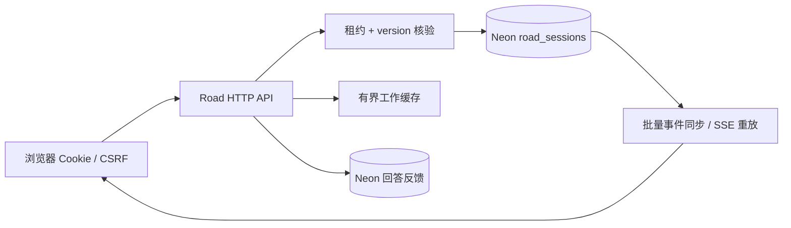
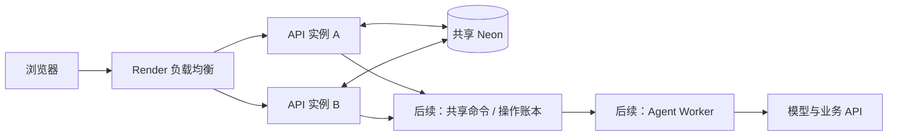

# Road 会话管理、容量与水平扩展

更新：2026-10-19。适用于 `codex/road-pothole-pi-poc` 的本地新实现；发布状态和测量边界见下文。SENTRA 情绪评测工作台使用另一套任务存储，情绪报告下载仍暂时屏蔽。

## 已落地的会话管理

之前的 `sessions.size >= 100` 检查数的是进程中累计保存的会话对象。创建后一直留在 Map、旧 JSON 又会在启动时全部载入，所以“100 个”是历史对象上限，不是测出的同时在线能力。

现在 Neon PostgreSQL 是会话事实来源，Map 仅保留可丢弃的工作缓存。普通启动必须有数据库；内存/文件适配器仅供显式注入的离线测试和评估使用。生产路径没有静默回退。

| 项目 | 当前行为 |
| --- | --- |
| 会话恢复 | 同一 HttpOnly Cookie 恢复身份、消息、计划、待补充信息、精确操作提案、API 回执、事件和反馈证据；重启不会重跑工具 |
| 持久化 | `road_sessions` 每会话一行，JSONB 保存完整聚合；数据库提交后才广播事件、确认已保存 |
| 工作缓存 | 默认最多 128 个空闲对象，闲置 5 分钟后可回收；在途操作与尚未保存的对象不驱逐；反馈缓存也限制为 128 个会话 |
| 过期 | 普通会话最后一次业务保存后 30 分钟过期；GET、SSE 心跳和刷新不续期；活跃租约阻止归档 |
| 人工会话 | 未完成的会话级人工交接受保护；完成人工交接后恢复普通过期规则 |
| 归档 | 保留历史，撤销待确认操作和授权，暂停未完成计划；提交过期事件并关闭 SSE，释放在线名额；API 返回 `410 SESSION_EXPIRED`，界面提供新对话并保留未发送草稿 |
| 同会话并发 | 原子领取 30 秒行租约，每约 10 秒续约；持有至整个 Agent turn 完成；其他实例返回 `409 BUSY` |
| 防止旧实例覆盖 | 每次保存同时核验版本、租约 token、数据库时间；过期持有者不能写入；续约失败会中止本机 Agent |
| 进程失联 | 租约过期后下一次读取/维护恢复为 interrupted，增加 epoch 并撤销授权；不自动重放外部写入 |
| 事件同步 | SSE 支持游标重放；每实例每 2 秒一条批量查询读取关注会话的已提交事件；单连接缓冲超过 256 KiB 时关闭并由浏览器重连 |
| 资源准入 | 默认每进程 8 个同时执行的 turn、500 条 SSE；满额返回 429 与 Retry-After；历史保存总数不再限制为 100 |
| 数据库失败 | 显式 503；不创建替代空会话，不假报业务完成 |

维护循环每分钟最多扫描 100 条待处理行，读取/写入也按需检查过期。归档不是物理删除；保留期限、用户主动删除和定期清理仍需按产品留存政策另行落地。Cookie 丢失后不会把历史分配给其他浏览器，当前没有账号下的历史会话列表。

当前数据模型：



`road_sessions` 包含 `session_id / payload / version / created_at / last_activity_at / expires_at / archived_at / protected / lease_token / lease_owner / lease_until`。过期和租约有索引。TLS 校验证书，SQL 参数化，URL 和凭证仅在后端；同会话租约不占用长 SQL 事务，也不依赖会话级 advisory lock 或 LISTEN，兼容 [Neon transaction pooling](https://neon.com/docs/connect/connection-pooling)。Neon 的连接上限不能换算为在线人数。

## 配置、迁移和验收

复用已有反馈数据库即可，不必再建数据库。`ROAD_SESSION_DATABASE_URL` 非空时优先使用；否则取 `ROAD_FEEDBACK_DATABASE_URL`。建议使用 Neon pooled URL。应用身份需有建表/索引权限；自定义 schema 需预先存在。

```dotenv
ROAD_SESSION_POOL_SIZE=5
ROAD_SESSION_CACHE_LIMIT=128
ROAD_SESSION_CACHE_IDLE_MS=300000
ROAD_SESSION_IDLE_TTL_MS=1800000
ROAD_SESSION_LEASE_MS=30000
ROAD_SESSION_EVENT_POLL_MS=2000
ROAD_MAX_INFLIGHT_TURNS=8
ROAD_MAX_EVENT_STREAMS=500
```

可选 `ROAD_SESSION_SCHEMA`（默认 public）、`ROAD_STATE_DIR`（默认 `.road-state`）。默认每实例最多 5 条会话池连接和 3 条反馈池连接；N 个实例预算约 `8N + 迁移/运维余量`，应同时核算 Neon compute 的后端连接能力和池化队列。

```sh
# 将仍可访问的旧实例 JSON 目录导入，保留 ID/Cookie/历史；重复执行不覆盖 Neon。
npm run road:session-migrate -- /absolute/path/to/legacy-state
# 真实数据库回归：创建、清理独立临时 schema。
npm run road:test:postgres
# 启动默认 Neon 路径。
npm run road:web
```

启动也会执行相同的幂等导入。旧待确认提交和运行中的任务会撤销授权，避免恢复时误提交；源文件保留。已经随 Render 临时盘丢失的 JSON 无法从不存在的文件恢复。迁移上线时应先停旧写入并取得旧目录，再导入、核对数量，最后切换新版本；不能让旧文件版和 Neon 版同时接受写入。

验收要求：同 Cookie 刷新/替换进程后保留身份和历史；100 个以上新会话不再触发旧保护；过期后旧确认不可执行；双实例只有一个持有者；旧实例保存失败；SSE 断线能重放；数据库不可达返回 503。`tests/road-session.postgres.mjs` 和 `tests/road-feedback.postgres.mjs` 覆盖这些数据库边界，不借用生产表做测试。

本轮验证：Node 工程测试 **156/156**、真实 Neon 测试 **19/19**、Python mock 测试 **26/26**，源码检查和凭证扫描通过。真实 Neon 测试包括续租、旧写入拒绝、数据库错误、过期 SSE 事件及连接关闭、服务重建恢复精确提案、重复确认仅一次 mock 提交。已向当前配置的 Neon 导入本地 **3 个会话、56 条消息**，源文件保留；默认服务器再次启动识别为 3 条已有记录，身份、Cookie token 和消息逐项核对一致。验证清单与最终源码指纹：[验证记录](evaluation/road-session-validation-20261017.json)。

## 当前服务与容量口径

2026-10-17 通过已确认的 Render `poc` 工作区读取配置：服务 `road-pothole-pi-poc`，Singapore，Docker，`free`，1 实例。该次核对时线上仍是 2026-10-16 的反馈版本；此处为历史配置记录，2026-10-19 发布前复验见下文。CPU/内存/实例数指标查询为空，不能据此宣称生产容量已验证。

[Render compute 文档](https://render.com/docs/compute-plans) 标明 Free 为 0.1 CPU、512 MB；[扩展文档](https://render.com/docs/scaling) 标明 Free 只能 1 实例，付费服务可手动增加实例，自动扩展要求 Pro workspace 或更高。没有修改当前套餐或产生扩容费用。

需要区分四个数字：历史会话数受数据库存储和保留政策影响；在线数主要是 SSE/网络/事件同步负担；同时处理数由 turn 准入、CPU 和内存限制；每秒完成数还受 FAQ/情绪/规划耗时、模型额度和下游 API 影响。数据库连接数和在线人数没有一一对应关系。

Neon 的具体 compute 套餐、区域、上游模型的账户额度尚未核实；本次能测量实际数据库链路，无法从现有凭证推断账户的扩容上限。

容量实测采用本机独立 Node 子进程、256 MiB V8 堆限制、真实 Neon、临时 schema，客户端负载在另一个进程；进程 RSS 单独采样。主机为 Intel i7-9750H / 32 GiB / Node 24.4.1，不能与 Render 的 CPU 直接等同。分别建立 100/250/500 条真实 HTTP/SSE 会话，每阶段闲置观察 15 秒，再以并发 12 逐会话读取状态，并以 16 个同时请求验证 8 个执行名额和超额拒绝。FAQ fixture 人为等待 5 秒，不发模型请求；不能据此推导真实 DeepSeek 吞吐。脚本结束删除测试 schema。

```sh
npm run road:capacity -- --output /tmp/capacity-8k.json --stage-seconds 15 --payload-kib 8
npm run road:capacity -- --output /tmp/capacity-64k.json --stage-seconds 15 --payload-kib 64
```

短会话实测，序列化后的实际数据库聚合约 8.9 KiB：

| 在线 SSE 连接 | 闲置采样 RSS | 状态读取 p95 | 缓存对象 | 请求错误 |
| --- | --- | --- | --- | --- |
| 100 | 147.88 MiB | 2,066 ms | 100 | 0 |
| 250 | 148.58 MiB | 1,884 ms | 128 | 0 |
| 500 | 149.66 MiB | 1,119 ms | 128 | 0 |

短会话 500 连接时，16 个同步请求接收 8 个、拒绝 8 个；全部执行名额最终释放。第 501 条 SSE 返回 429，断开后连接和事件订阅均为 0。短历史结果不能代替长历史或长时间 soak 测试。原始结果：[8 KiB 负载](evaluation/road-session-capacity-8k-20261017.json)。

长会话实测，实际数据库聚合约 64.8 KiB：

| 在线 SSE 连接 | 闲置采样 RSS | 状态读取 p95 | 缓存对象 | 请求错误 |
| --- | --- | --- | --- | --- |
| 100 | 170.38 MiB | 3,562 ms | 100 | 0 |
| 250 | 209.39 MiB | 6,391 ms | 128 | 0 |
| 500 | 249.09 MiB | 6,200 ms | 128 | 0 |

长会话 500 连接阶段读取后采样 RSS 255.05 MiB，同样接收 8 个任务、拒绝 8 个并最终释放；其 POST 准入响应 p95 约 12.5 秒（短会话约 2.7 秒），不是模型任务完成耗时。原始结果：[64 KiB 负载](evaluation/road-session-capacity-64k-20261017.json)。两轮处于不同时间，结果包含远程网络与 Neon 链路波动，不能用差值直接推导每人 CPU/RAM，也不能把配置上限当成最大容量。短轮次测试证明了这组负载能完成；长历史的状态读取和准入响应已提示交互体验需要优化。

建议当前 **Free 单实例**先采用以下试运行配额，业务压测通过后再调大：

```dotenv
ROAD_MAX_EVENT_STREAMS=50
ROAD_MAX_INFLIGHT_TURNS=2
```

这是给试运行留余量的准入策略，不是已证明的线上容量。50 条在线连接可以大多处于阅读/等待状态，不能承诺 50 人持续同时聊天。新版本默认 500/8 仅表示可配置的程序保护边界，不应直接作为 Free 实例承诺。Free 的模型任务内存、长历史、冷启动、真实业务 p95 和上游限流均需在发布后以小步负载验证。

吞吐估算使用 `每秒完成 turn ≈ 同时执行名额 / 平均 turn 秒数`。例如每轮 10 秒、8 个名额，理论约 0.8 turn/s；每轮 30 秒时约 0.27 turn/s。此为排队公式举例，未计重试、数据库时间和上游限流，不是服务承诺。实际轮次可能包含 FAQ 判断、情绪判断和多个 PI 请求，不能把一次情绪分类耗时当成完整业务轮次耗时。

## 水平扩展落地方案

本次完成共享状态、行租约与跨实例事件重放。业务 mock 仍在持有租约的进程内执行，并把结果保存回同一聚合。正式接入外部业务 API 时，数据库提交与远端提交不是同一个事务，必须补操作账本和对账；不能声称端到端 exactly-once。



分三步实施：

1. **先稳定单实例。** 部署 Neon 版本，设置 `/healthz` 为进程存活检查；补数据库 readiness、turn 等待/拒绝数、模型延迟、DB pool waiting、RSS、事件延迟和归档计数。Free 先用保守准入做线上压测，再决定付费资源。
2. **补齐多实例控制后扩到 2 个付费实例。** 当前取消只支持拥有该运行任务的实例；请求落到另一实例返回 BUSY，不能依赖平台碰巧把请求送回同一处。增加 `session_commands(command_id, session_id, expected_epoch, type, payload, status)`：先实现跨实例 cancel，持有者定期读取并中断；命令处理和状态保存检查同一 epoch/租约，支持幂等。每个实例保留本机私有 mock harness key即可；共享数据库URL、网站访问配置和代码版本必须一致。上线前必须通过 A 执行/B 取消、A 宕机/B 接管、重复确认不重复写入、SSE 连到 B 仍能收到 A 事件的双进程集成压测。
3. **按指标拆 API/Worker。** 长模型调用由共享命令队列调度，Worker 领取租约；API 负责会话、确认和 SSE。模型并发/费用配额使用全局控制，不能把每实例 8 个名额直接累加到超出上游能力。需要更低事件延迟时才引入 Redis/Valkey pubsub，Neon 中的持久事件仍供重放。先观测现有每实例每 2 秒批量查询的代价，避免提前添加基础设施。

进程缩容先停止准入、关闭 SSE 使其重连，尽力中断并持久化正在执行的任务、释放租约；异常退出由租约过期恢复。当前 SIGTERM 最多等待 15 秒，慢请求可能以 interrupted 恢复，需要在业务接入时加入更完整的 drain/readiness 状态。增加实例不能解除同一会话的串行约束。

扩容触发建议先定为：持续 5 分钟 CPU >60% 或 RSS >70%，或 turn 拒绝率 >1%、DB 等待持续增长、业务 p95 超出约定目标。模型等待导致的拥塞可能 CPU 很低，需单独告警并控制队列。具体阈值是初始运维建议，需用业务压测修订；Render 原生自动扩容目前基于 CPU/内存，不能代替应用层模型额度控制。

## 下一阶段必须关注的上限

- 当前 JSONB 保存整个会话，每次写入及部分读取会复制历史。缓存按会话数量限制，未按字节限制；超长会话仍可能耗尽内存。扩量前拆 `session_messages / session_events / operation_receipts`，游标分页、增量写入、上下文裁剪，并增加单会话字节/消息限额。
- SSE 现在可能触发完整 `/api/state`，高频事件造成重复整包读取。下一阶段合并刷新、增量事件应用和消息分页，减少 JSON 序列化与网络流量。
- 行租约阻止旧状态落库，无法原子撤销已经发往真实下游的 HTTP 请求。外部写入需要稳定幂等键、proposal/epoch 账本、UNKNOWN 状态和回执对账，再允许人工重试。
- 后续上线账号权限、会话列表与删除、数据留存策略；当前仍是受网站密码保护的 mock PoC。

本方案先复用 Neon，当前没有引入 Redis、独立 Worker 或新的付费实例；后续步骤有明确依赖与验收条件。

## 2026-10-19 发布前完整复验

当前实现通过 156 项 Node 工程测试、26 项 Python mock、19 项真实 Neon 边界测试、60 个离线工程案例、23 个真实模型业务案例和 48 个情绪模型案例。23 个合成业务案例的工具选择 Precision/Recall 均为 100%，无越权写入；这是本轮样本结果。旧评测工作台 `value` 分支另通过 87 项 Node、26 项 Python 和 18 项下载接口检查。

最终会话代码重新完成 8 KiB / 64 KiB 历史各 100、250、500 连接的容量检查，全部通过；仍是本地独立服务器加真实 Neon，不是 Render Free 的容量承诺。本次部署配置采用每实例 2 个同时执行 turn、50 条 SSE 的试运行准入值，未调整套餐或增加实例。验证和原始容量数据见 [发布前验证记录](evaluation/road-release-validation-20261019.json)。

本次不再次导入本地历史聊天。旧 Render 临时盘会话没有可用的迁移导出路径，切换后可能需要新建对话；已有 Neon 反馈不删除。新版本从落地后将完整会话写入 Neon。上线后会单独验证替换 Render 进程后相同 Cookie、问答、精确提案和评分恢复，以及重复确认不会再次创建工单。
